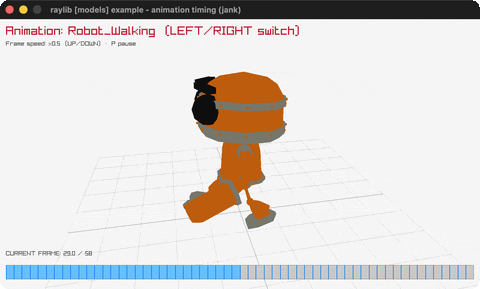

# animation-timing

The robot with a playback timeline + adjustable speed.

Category: models. Controls: LEFT/RIGHT anim, UP/DOWN speed, P pause, ESC.

Ported from raylib's `examples/models/models_animation_timing.c`.



## Run it

```sh
cd animation-timing && bb run   # from this demo (or lein run --disable-sandbox)
bb animation-timing             # from the repo root
```

It loads files from the vendored raylib checkout (`jank-raylib-sys/raylib/examples/models/resources/`) by a path relative to this directory, so run it from here. The repo's `jank-raylib-sys/raylib` submodule has to be checked out.

## About

raylib [models] example - animation timing, ported to jank.

The glTF robot with a playback timeline: LEFT/RIGHT switch
animations, UP/DOWN change the play speed (x0.1 to x2.0), P pauses;
the bottom bar shows playback progress with a tick per keyframe.
Orbital camera. ESC quits.
Based on raylib/examples/models/models_animation_timing.c

jank-native notes:
- The raygui dropdown/slider/progress-bar become keyboard controls
  + a hand-drawn timeline (filled bar + keyframe ticks).
- This example plays INTERPOLATED frames (fractional speeds), so the
  frame reaches UpdateModelAnimation as a cpp/float - unlike the
  earlier int-frame animation ports.
- The C starts on animation index 10 (the robot's walk); kept.
