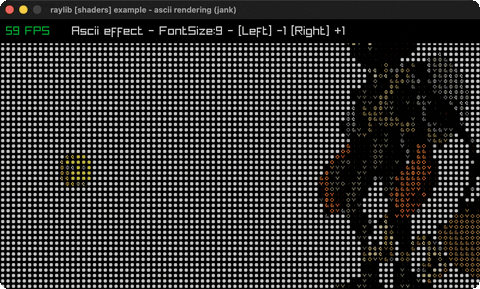

# ascii-rendering

A shader re-rendering the scene as ASCII glyphs.

Category: shaders. Controls: LEFT/RIGHT cell size, ESC.

Ported from raylib's `examples/shaders/shaders_ascii_rendering.c`.



## Run it

```sh
cd ascii-rendering && bb run   # from this demo (or lein run --disable-sandbox)
bb ascii-rendering             # from the repo root
```

It loads files from the vendored raylib checkout (`jank-raylib-sys/raylib/examples/shaders/resources/`) by a path relative to this directory, so run it from here. The repo's `jank-raylib-sys/raylib` submodule has to be checked out.

## About

raylib [shaders] example - ASCII rendering, ported to jank.

A post-process fragment shader re-renders the scene as ASCII glyphs.
Two sprites (one bouncing) are drawn into a RenderTexture, then the
whole texture is drawn back through the ascii shader. LEFT/RIGHT
change the glyph cell size (9..15); ESC quits.
Based on raylib/examples/shaders/shaders_ascii_rendering.c

jank-native notes:
- Same postprocess-over-RenderTexture pipeline as custom-uniform: draw
  the 2D scene into `target`, then draw target.texture once through
  BeginShaderMode, y-flipped via a negative-height source Rectangle.
- Uniforms: resolution VEC2 (set once) + fontSize FLOAT (per frame),
  both via the scalar C setters. All animation state (the bounce x, its
  speed, the font size) threads through recur as plain jank doubles -
  no native value crosses the loop.
