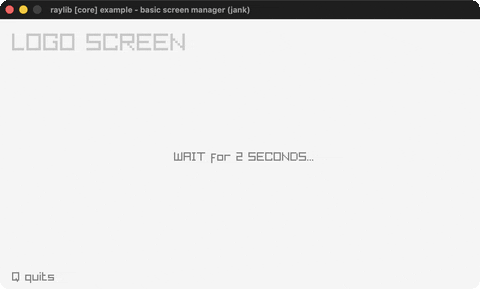

# basic-screen-manager

A LOGO/TITLE/GAMEPLAY/ENDING flow.

Category: core. Controls: ENTER advance · Q quit.

Ported from raylib's `examples/core/core_basic_screen_manager.c`.



## Run it

```sh
cd basic-screen-manager && bb run   # from this demo (or lein run --disable-sandbox)
bb basic-screen-manager             # from the repo root
```

## About

raylib [core] example - basic screen manager, ported to jank.

A minimal screen state machine: LOGO (waits 2s) -> TITLE -> GAMEPLAY ->
ENDING -> TITLE. Press ENTER to advance, Q quits.
Based on raylib/examples/core/core_basic_screen_manager.c
