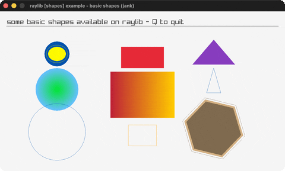

# basic-shapes

A gallery of raylib's basic shapes.

Category: shapes. Controls: Q quit.

Ported from raylib's `examples/shapes/shapes_basic_shapes.c`.



## Run it

```sh
cd basic-shapes && bb run   # from this demo (or lein run --disable-sandbox)
bb basic-shapes             # from the repo root
```

## About

raylib [shapes] example - basic shapes, ported to jank.

A gallery of the basic shapes raylib can draw (circles, ellipses,
rectangles, triangles, polygons, gradients). The hexagons spin. Q quits.
Based on raylib/examples/shapes/shapes_basic_shapes.c
(jank-native: Vector2 built inline for the gradient/triangle/poly calls).
