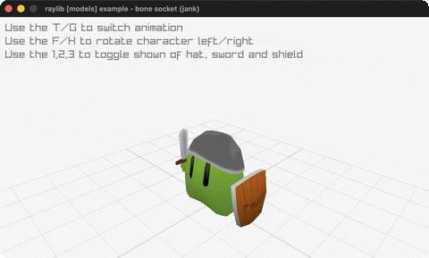

# bone-socket

A hat, sword and shield riding the greenman's bones.

Category: models. Controls: T/G anim, F/H rotate, 1/2/3 equip, ESC.

Ported from raylib's `examples/models/models_bone_socket.c`.



## Run it

```sh
cd bone-socket && bb run   # from this demo (or lein run --disable-sandbox)
bb bone-socket             # from the repo root
```

It loads files from the vendored raylib checkout (`jank-raylib-sys/raylib/examples/models/resources/`) by a path relative to this directory, so run it from here. The repo's `jank-raylib-sys/raylib` submodule has to be checked out.

## About

raylib [models] example - bone socket, ported to jank.

The greenman character with equipment attached to skeleton BONES:
a hat, sword and shield ride named socket bones through every
animation frame. T/G switch animations, F/H rotate the character,
1/2/3 toggle the hat/sword/shield. Third-person camera. ESC quits.
Based on raylib/examples/models/models_bone_socket.c

jank-native notes:
- Bone lookup by name walks skeleton.bones[] with cpp/TextIsEqual and
  returns an int. The per-socket quaternion math (animation-frame bone
  rotation against bind pose, then translate plus the character
  transform) is jank, with the Model, equipment and animation array
  all passed boxed.
- Equip visibility is three jank bools threaded through recur.
- The C updates the animation twice per frame (once in update, once
  after setting the transform) - kept.
