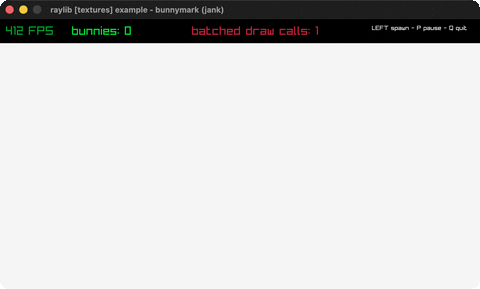

# bunnymark

The classic bunny-spawning batching benchmark.

Category: textures. Controls: LEFT spawn · P pause · Q quit.

Ported from raylib's `examples/textures/textures_bunnymark.c`.



## Run it

```sh
cd bunnymark && bb run   # from this demo (or lein run --disable-sandbox)
bb bunnymark             # from the repo root
```

It loads files from the vendored raylib checkout (`jank-raylib-sys/raylib/examples/textures/resources/`) by a path relative to this directory, so run it from here. The repo's `jank-raylib-sys/raylib` submodule has to be checked out.

## About

raylib [textures] example - bunnymark, ported to jank.

The classic batching benchmark: hold LEFT to spawn 100 bunnies per
frame at the cursor, each bouncing off the screen edges. P pauses,
Q quits. The FPS counter shows what the runtime can sustain.
Based on raylib/examples/textures/textures_bunnymark.c
(jank-native: bunnies are jank maps in a persistent vector instead
of a malloc'd struct array, so throughput measures jank's
collection update rate as much as raylib's draw batching. Each
bunny's color is stored as r/g/b ints and resolved per draw via
GetColor on a packed RGBA int.)
