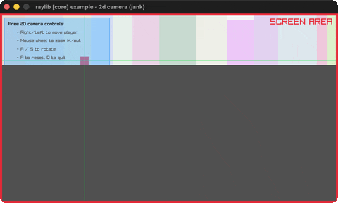

# camera-2d

A free 2D camera over a skyline.

Category: core. Controls: arrows move · WHEEL zoom · A/S rotate · R reset · Q.

Ported from raylib's `examples/core/core_2d_camera.c`.



## Run it

```sh
cd camera-2d && bb run   # from this demo (or lein run --disable-sandbox)
bb camera-2d             # from the repo root
```

## About

raylib [core] example - 2D camera, ported to jank.

A free 2D camera over a skyline. RIGHT/LEFT move the player (the camera
follows), mouse wheel zooms, A/S rotate, R resets, Q quits.
Based on raylib/examples/core/core_2d_camera.c
(jank-native: Camera2D built inline each frame from threaded scalars -
a native struct can't live in loop state - with nested Vector2s).
