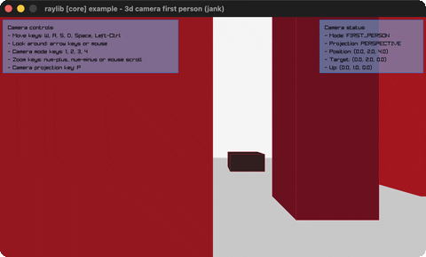

# camera-3d-first-person

Walk a yard of random columns in first person.

Category: core. Controls: WASD + mouse, 1-4 camera mode, P projection, ESC.

Ported from raylib's `examples/core/core_3d_camera_first_person.c`.



## Run it

```sh
cd camera-3d-first-person && bb run   # from this demo (or lein run --disable-sandbox)
bb camera-3d-first-person             # from the repo root
```

## About

raylib [core] example - 3d camera first person, ported to jank.

Walk a walled yard of random columns in first person: WASD moves,
mouse looks, keys 1-4 switch camera mode (FREE / FIRST_PERSON /
THIRD_PERSON / ORBITAL), P toggles an isometric orthographic view.
A status box tracks mode, projection and camera vectors. ESC quits
(the cursor is captured).
Based on raylib/examples/core/core_3d_camera_first_person.c

jank-native notes:
- Second UpdateCamera((cpp/& camera) mode) example; the mode enum is
  threaded as a boxed (cpp/int cpp/CAMERA_*) jank int and passed back
  through UpdateCamera's int param (the keyboard-testbed enum trick).
- The C's camera field writes (up resets on mode keys, the whole
  isometric/perspective switch) are cpp/= on the field:
  (cpp/= (.-up camera) (cpp/Vector3 ...)).
- The 20 random columns are jank maps ({:h :x :z :rgba}) with packed
  colors resolved via GetColor at draw; camera.target passes straight
  from the field read into DrawCube.
- The C's %06.3f status readout becomes a plain 3-decimal trim (no
  zero padding).
