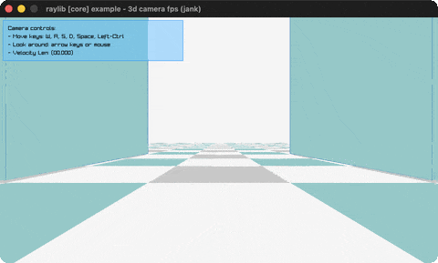

# camera-3d-fps

A physics FPS controller with head-bob and lean.

Category: core. Controls: WASD move, SPACE jump, Left-Ctrl crouch, mouse look, ESC.

Ported from raylib's `examples/core/core_3d_camera_fps.c`.



## Run it

```sh
cd camera-3d-fps && bb run   # from this demo (or lein run --disable-sandbox)
bb camera-3d-fps             # from the repo root
```

## About

raylib [core] example - 3d camera fps, ported to jank.

A physics-driven first-person controller: WASD to move, Space to jump,
Left-Ctrl to crouch, mouse (or arrow keys) to look. The body carries
velocity with gravity, ground friction / air drag, acceleration
clamping (the classic strafe-accel trick) and a head-bob / lean that
eases the camera. The level is a checkerboard floor, four towers and a
red sun.
Based on raylib/examples/core/core_3d_camera_fps.c (3/4 complexity).

jank-native notes:
- The controller state is a plain jank map of numbers, not a native
  struct. A Vector3 may not be returned from a jank fn, but its three
  floats cross freely, so decomposing the body into :px/:py/:pz and
  friends sidesteps the native-value-lifetime rule entirely rather
  than working around it with boxes.
- The two raymath calls worth keeping are Vector3RotateByAxisAngle and
  Vector3Angle. Both are wrapped to take and return [x y z] vectors of
  numbers, constructing the native Vector3 inline and reading the
  components straight back off the result. The rest (lerp, cross,
  scale, dot, length) is a line of jank arithmetic each.
- Only the Camera3D is boxed: BeginMode3D needs the real struct, and
  one allocation outside the frame loop beats rebuilding it per frame.
- The diagonal-input normalization (the C's NORMALIZE_INPUT, which is
  #defined so its #if is active) is kept.
