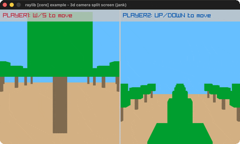

# camera-3d-split-screen

Two players, two 3D cameras, split screen.

Category: core. Controls: W/S player 1, UP/DOWN player 2, ESC.

Ported from raylib's `examples/core/core_3d_camera_split_screen.c`.



## Run it

```sh
cd camera-3d-split-screen && bb run   # from this demo (or lein run --disable-sandbox)
bb camera-3d-split-screen             # from the repo root
```

## About

raylib [core] example - 3d camera split screen, ported to jank.

Two players roam a plane of cube trees, each seeing the world from
their own camera in half the screen: player 1 moves with W/S (along
z), player 2 with UP/DOWN (along x); each is drawn as a colored cube
in both views. ESC quits.
Based on raylib/examples/core/core_3d_camera_split_screen.c

jank-native notes:
- The C nudges camera fields directly (position.z += ...); the port
  threads the two moving coordinates as jank reals and rebuilds both
  Camera3Ds inline each frame (the billboard-rendering pattern) - no
  pointer shims needed at all.
- The C duplicates the whole scene block per view; the port factors
  draw-scene, a helper taking only jank scalars (safe: no native
  params, no cpp/raw statics).
- Both half-screen RenderTextures are create-once outer-let locals;
  the y-flipped source rect is built inline at each DrawTextureRec.
