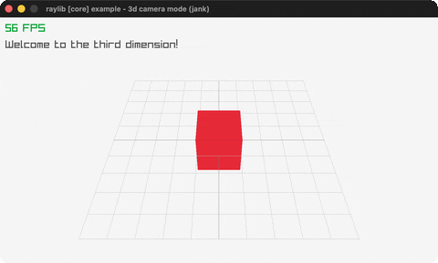

# camera-3d

A red cube on a grid through a fixed 3D camera.

Category: core. Controls: watch · Q quit.

Ported from raylib's `examples/core/core_3d_camera_mode.c`.



## Run it

```sh
cd camera-3d && bb run   # from this demo (or lein run --disable-sandbox)
bb camera-3d             # from the repo root
```

## About

raylib [core] example - 3d camera mode, ported to jank.

The canonical minimal 3D scene: a single red cube (solid +
wireframe) sitting on a grid, viewed through a fixed perspective
camera. Welcome to the third dimension! Q quits.
Based on raylib/examples/core/core_3d_camera_mode.c
(jank-native: the Camera3D is an outer-let local and every Vector3
is constructed inline as a call argument.)
