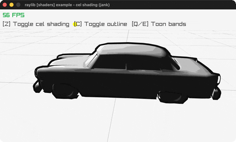

# cel-shading

A GLB car toon-shaded with quantized bands + outline.

Category: shaders. Controls: Z cel, C outline, Q/E bands, ESC.

Ported from raylib's `examples/shaders/shaders_cel_shading.c`.



## Run it

```sh
cd cel-shading && bb run   # from this demo (or lein run --disable-sandbox)
bb cel-shading             # from the repo root
```

It loads files from the vendored raylib checkout (`jank-raylib-sys/raylib/examples/shaders/resources/`) by a path relative to this directory, so run it from here. The repo's `jank-raylib-sys/raylib` submodule has to be checked out.

## About

raylib [shaders] example - cel shading, ported to jank.

A GLB car model toon-shaded with quantized light bands plus an
inverted-hull silhouette outline, under one white directional light
spinning against the orbital camera. Z toggles cel shading, C the
outline, Q/E change the band count. ESC quits.
Based on raylib/examples/shaders/shaders_cel_shading.c

jank-native notes:
- First GLB LoadModel (the format beyond OBJ). The model's default
  shader is boxed as an explicit COPY so Z can restore it: reading
  .-shader gives a Shader& INTO the model, which would alias every
  later write. Swapping shaders goes through models.jank per press
  and per outline pass.
- The spinning light uses rlights' set-light-pos! + update-light!;
  its indicator sphere position is the same
  sin/cos math on the jank side.
- rlSetCullFace takes the RL_CULL_FACE_* enum directly (rlgl.h).
- The C's Clamp reduces to nested ifs; numBands is re-sent per
  frame, matching the C.
