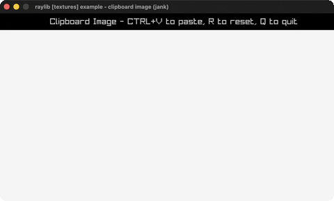

# clipboard-image

Paste images from the system clipboard.

Category: textures. Controls: CTRL+V paste, R reset, Q.

Ported from raylib's `examples/textures/textures_clipboard_image.c`.



## Run it

```sh
cd clipboard-image && bb run   # from this demo (or lein run --disable-sandbox)
bb clipboard-image             # from the repo root
```

## About

raylib [textures] example - clipboard image, ported to jank.

CTRL+V pastes an image from the system clipboard and drops it at the
mouse position; R clears the collection; Q quits. Up to 20 images.
Based on raylib/examples/textures/textures_clipboard_image.c
(jank-native: the C keeps a fixed TextureCollection[20] of native
Texture2D structs. A Texture2D created mid-loop has to outlive the
frame that made it, so each one is boxed with cpp/new + cpp/box and
held in a jank vector in an atom, alongside its drop position as
plain numbers - see docs/guide/native-value-lifetimes.md.)
