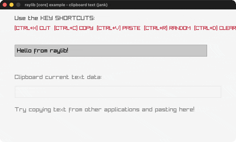

# clipboard-text

Type + cut/copy/paste with the system clipboard.

Category: core. Controls: type, CTRL+X/C/V/R/D, ESC.

Ported from raylib's `examples/core/core_clipboard_text.c`.



## Run it

```sh
cd clipboard-text && bb run   # from this demo (or lein run --disable-sandbox)
bb clipboard-text             # from the repo root
```

## About

raylib [core] example - clipboard text, ported to jank.

Type into the box, then use the system clipboard: CTRL+C copies, CTRL+X
cuts, CTRL+V pastes (from THIS app or any other application), CTRL+R
drops in a random sample string, and CTRL+D clears. The current
clipboard contents are shown in the lower box. ESC quits.
Based on raylib/examples/core/core_clipboard_text.c

jank-native notes:
- The C is a raygui showcase (GuiTextBox / GuiButton / GuiLabel). Per the
  repo's raygui-to-keyboard pattern the buttons become CTRL shortcuts and
  the text box becomes a jank-managed string edited with GetCharPressed +
  BACKSPACE (the input-box technique). CTRL+letter combos don't emit a
  character through GetCharPressed, so command keys never pollute the
  buffer.
- GetClipboardText returns a native `const char *` that jank's `str` folds
  straight into a jank string (proven in monitor-detector); a jank string
  passes straight back to SetClipboardText's `const char *` param. The
  pointer can be NULL on an empty/unset clipboard, so an `if` coalesces
  it first. Note `(cpp/!= s cpp/nullptr)` does NOT compile ("Binary
  operator != is not supported for 'const char *' and 'std::nullptr_t'");
  `(cpp/bool s)` does.
