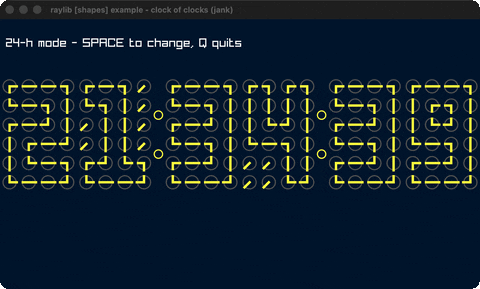

# clock-of-clocks

Digits drawn from grids of little clocks.

Category: shapes. Controls: SPACE 12/24h · Q quit.

Ported from raylib's `examples/shapes/shapes_clock_of_clocks.c`.



## Run it

```sh
cd clock-of-clocks && bb run   # from this demo (or lein run --disable-sandbox)
bb clock-of-clocks             # from the repo root
```

## About

raylib [shapes] example - clock of clocks, ported to jank.

Each of the six time digits is a 4x6 grid of little clocks whose two
hands sweep to form the digit's strokes. Reads the real system time;
SPACE toggles 12/24-hour mode, Q quits.
Based on raylib/examples/shapes/shapes_clock_of_clocks.c
(jank-native: C time()/localtime(); the [6*24] hand-angle state is held
as flat jank vectors of [big-angle little-angle] pairs and lerped each
frame; colors built inline via ColorLerp).
