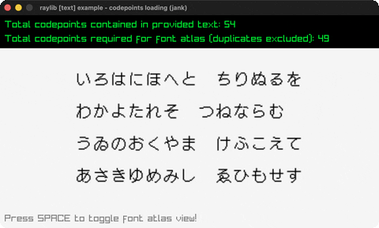

# codepoints-loading

Japanese text rasterized to a minimal TTF font atlas.

Category: text. Controls: SPACE toggle atlas view, ESC.

Ported from raylib's `examples/text/text_codepoints_loading.c`.



## Run it

```sh
cd codepoints-loading && bb run   # from this demo (or lein run --disable-sandbox)
bb codepoints-loading             # from the repo root
```

It loads files from the vendored raylib checkout (`jank-raylib-sys/raylib/examples/text/resources/`) by a path relative to this directory, so run it from here. The repo's `jank-raylib-sys/raylib` submodule has to be checked out.

## About

raylib [text] example - codepoints loading, ported to jank.

Japanese text (the Iroha pangram) scanned for its unicode codepoints,
which are deduplicated and used to rasterize a minimal TTF font atlas
(DotGothic16). SPACE toggles between the rendered text and the
generated atlas texture. ESC quits.
Based on raylib/examples/text/text_codepoints_loading.c

jank-native notes:
- LoadCodepoints returns int* + a count out-param: the (cpp/int 0) +
  (cpp/& n) pattern, with the array read back element-wise via
  (cpp/aget cps (cpp/int i)) - the first committed load-bearing use
  of aget on an int*.
- The C's CodepointRemoveDuplicates (calloc + memcpy + triple loop)
  becomes a jank first-occurrence dedup over a set. Writing the result
  BACK to the int* LoadFontEx wants goes through cpp/MemAlloc plus
  cpp/unsafe-cast, filled element-wise with cpp/aget and cpp/=.
- The TEXT literal is UTF-8 in the source, like the C. jank's lexer
  accepts UTF-8 inside string literals; the ASCII-only rule is about
  comments.
- The C's RIGHT/LEFT GetCodepointNext/Previous block only moves a
  pointer and draws nothing - testing dead code, dropped here.
