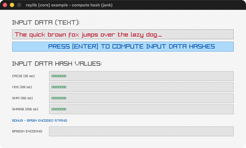

# compute-hash

CRC32/MD5/SHA1/SHA256 + Base64 of typed text.

Category: core. Controls: type, BACKSPACE delete, ENTER compute, ESC.

Ported from raylib's `examples/core/core_compute_hash.c`.



## Run it

```sh
cd compute-hash && bb run   # from this demo (or lein run --disable-sandbox)
bb compute-hash             # from the repo root
```

## About

raylib [core] example - compute hash, ported to jank.

Type into the input box (BACKSPACE deletes) and press ENTER to compute
the CRC32 / MD5 / SHA1 / SHA256 hashes of the text, plus its Base64
encoding. ESC quits.
Based on raylib/examples/core/core_compute_hash.c

jank-native notes:
- The C is a raygui showcase (GuiTextBox / GuiButton / GuiLabel); per the
  repo's raygui-to-keyboard pattern the textbox is always type-enabled
  (GetCharPressed + the ASCII-table subs trick from input-box) and the
  COMPUTE button becomes ENTER.
- ComputeMD5/SHA1/SHA256 take unsigned char* (a jank string only converts
  to const char*), so cpp/cast to const char* then cpp/unsafe-cast to
  unsigned char*: both, in that order. Their returned
  static unsigned int arrays are read with (cpp/aget p (cpp/int i)) -
  the first proven native array subscript in this repo (previously the
  'known-blocked' interop class); the u32 elements box to jank ints
  correctly, verified against the canonical CRC32 / SHA1 / SHA256 test
  vectors of 'The quick brown fox jumps over the lazy dog'. (MD5 shows
  raylib's raw little-endian words, exactly like the C's %08X display.)
  EncodeDataBase64's char* return + int* out-param round-trips through
  the (cpp/int 0) + (cpp/& n) pattern, with cpp/MemFree on the malloc'd
  text (the C itself leaks each recompute).
- The C's %08X becomes a small quot/mod hex loop (rule 3: mod/quot return
  reals, re-int before use).
