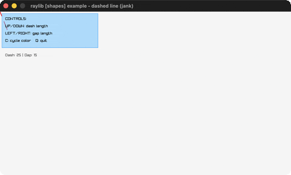

# dashed-line

A dashed line follows the mouse.

Category: shapes. Controls: ARROWS size · C color · Q quit.

Ported from raylib's `examples/shapes/shapes_dashed_line.c`.



## Run it

```sh
cd dashed-line && bb run   # from this demo (or lein run --disable-sandbox)
bb dashed-line             # from the repo root
```

## About

raylib [shapes] example - dashed line, ported to jank.

A dashed line runs from a fixed point to the mouse. UP/DOWN change the
dash length, LEFT/RIGHT the gap, C cycles the color, Q quits.
Based on raylib/examples/shapes/shapes_dashed_line.c. raylib's own
DrawLineDashed is an example-local helper, so the dashes are drawn here
as DrawLineEx segments (jank-native: C sqrt, Vector2 built inline).
