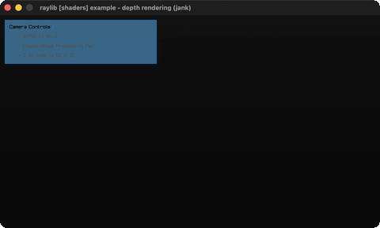

# depth-rendering

The scene's depth buffer visualized through a shader.

Category: shaders. Controls: WASD + mouse look, Z retarget, ESC.

Ported from raylib's `examples/shaders/shaders_depth_rendering.c`.



## Run it

```sh
cd depth-rendering && bb run   # from this demo (or lein run --disable-sandbox)
bb depth-rendering             # from the repo root
```

It loads files from the vendored raylib checkout (`jank-raylib-sys/raylib/examples/shaders/resources/`) by a path relative to this directory, so run it from here. The repo's `jank-raylib-sys/raylib` submodule has to be checked out.

## About

raylib [shaders] example - depth rendering, ported to jank.

The scene's DEPTH buffer visualized: a cube and a floor plane are
rendered into a custom framebuffer whose depth attachment is a
readable texture, then that depth texture is drawn to the screen
through the depth_render shader (near = dark, far = light). Free
camera: WASD move, mouse look, wheel-press pan, Z re-target. ESC
quits.
Based on raylib/examples/shaders/shaders_depth_rendering.c

jank-native notes:
- Same rendertex.jank depth target as depth-writing (a depth
  TEXTURE instead of raylib's default renderbuffer); the depth
  texture is read back with (.-depth target) and handed to both
  SetShaderValueTexture and DrawTexture.
- The C's LoadModelFromMesh(GenMeshCube/GenMeshPlane) models reduce
  to DrawCube / DrawPlane primitives (the basic-voxel untextured
  DrawModel substitution): the 1x1x1 cube at scale 3 becomes a
  3x3x3 DrawCube, the 20x20 plane at scale 2 a 40x40 DrawPlane.
- flipY is the INT-uniform per-type setter (the mandelbrot-set
  lesson, as a scalar setter).
