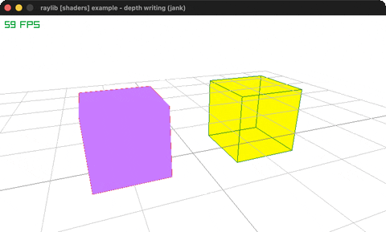

# depth-writing

Inverted gl_FragDepth into a custom depth texture.

Category: shaders. Controls: ESC.

Ported from raylib's `examples/shaders/shaders_depth_writing.c`.



## Run it

```sh
cd depth-writing && bb run   # from this demo (or lein run --disable-sandbox)
bb depth-writing             # from the repo root
```

It loads files from the vendored raylib checkout (`jank-raylib-sys/raylib/examples/shaders/resources/`) by a path relative to this directory, so run it from here. The repo's `jank-raylib-sys/raylib` submodule has to be checked out.

## About

raylib [shaders] example - depth writing, ported to jank.

Two cubes on a grid, orbited by an auto camera, rendered into a
custom RenderTexture whose depth buffer is a writable TEXTURE (not
raylib's default renderbuffer). The depth_write shader inverts the
depth of everything it draws (gl_FragDepth = 1 - gl_FragCoord.z),
so nearer fragments LOSE the depth test - the scene renders
inside-out. ESC quits.
Based on raylib/examples/shaders/shaders_depth_writing.c

jank-native notes:
- The C builds its custom framebuffer with rlgl calls
  (rlLoadFramebuffer / rlLoadTexture / rlLoadTextureDepth /
  rlFramebufferAttach) and hand-fills the RenderTexture2D struct
  fields. That is rendertex.jank's load-depth! / unload-depth!, which
  returns the target boxed.
- Everything else is proven ground: UpdateCamera((cpp/& camera)
  CAMERA_ORBITAL) on an outer-let Camera3D, inline cpp/Vector3 draw
  args, and the y-flipped DrawTextureRec blit.
