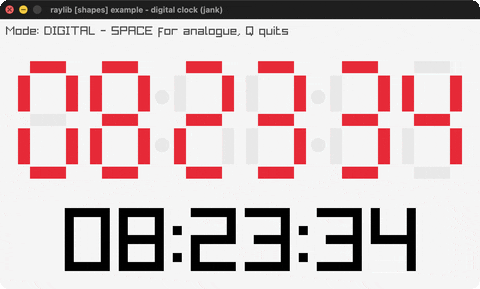

# digital-clock

A live clock (digital + analogue modes).

Category: shapes. Controls: SPACE mode · Q quit.

Ported from raylib's `examples/shapes/shapes_digital_clock.c`.



## Run it

```sh
cd digital-clock && bb run   # from this demo (or lein run --disable-sandbox)
bb digital-clock             # from the repo root
```

## About

raylib [shapes] example - digital clock, ported to jank.

A live clock reading the system time, in two modes: a 7-segment digital
display and an analogue clock. SPACE switches modes, Q quits.
Based on raylib/examples/shapes/shapes_digital_clock.c

jank-native notes: the wall-clock time comes from C time()/localtime()
and struct tm field access (tm_hour/tm_min/tm_sec). The upstream digital
mode draws each 7-segment bar with DrawTriangleStrip over a Vector2
array; here each segment is a DrawRectangle bar instead (an LED-style
simplification - jank can't easily pass a native Vector2 array). The
analogue mode is faithful (DrawLineEx ticks + DrawRectanglePro hands).
