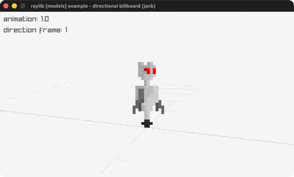

# directional-billboard

A sprite-sheet billboard that turns as the camera orbits.

Category: models. Controls: ESC.

Ported from raylib's `examples/models/models_directional_billboard.c`.



## Run it

```sh
cd directional-billboard && bb run   # from this demo (or lein run --disable-sandbox)
bb directional-billboard             # from the repo root
```

It loads files from the vendored raylib checkout (`jank-raylib-sys/raylib/examples/models/resources/`) by a path relative to this directory, so run it from here. The repo's `jank-raylib-sys/raylib` submodule has to be checked out.

## About

raylib [models] example - directional billboard, ported to jank.

A sprite-sheet character (skillbot) is drawn as a billboard that always
faces the camera, and the row of the sheet is chosen from the camera's
orbit angle so the character appears to turn as the camera circles it;
the column cycles through a 4-frame walk animation. ESC quits.
Based on raylib/examples/models/models_directional_billboard.c

jank-native notes:
- The C's UpdateCamera(&camera, CAMERA_ORBITAL) needs a pointer jank
  can't form, so (like billboard_rendering) the orbit is done by
  REBUILDING the Camera3D inline each frame from a jank-tracked angle
  `theta`. The camera sits at (Rxz*cos t, 1, Rxz*sin t) around the
  target, matching the C's start pose at t = PI/4.
- Because we own `theta`, the C's
  `Vector2Angle((2,0),(camera.x,camera.z))` collapses to `theta`
  itself, so the direction frame is `floor(theta/PI*4 + 0.25)` with the
  same negative-wrap correction.
- The billboard texture is a native Texture2D held as an outer-let
  local; the rebuilt native Camera3D and it are passed straight to
  DrawBillboardPro (native values as call args are fine - rule 2 only
  forbids returning / loop-carrying them).
