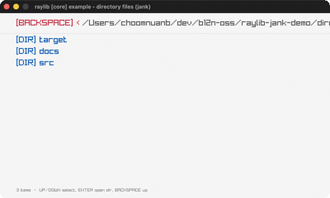

# directory-files

A keyboard file browser over the working directory.

Category: core. Controls: UP/DOWN select, ENTER open dir, BACKSPACE up, ESC.

Ported from raylib's `examples/core/core_directory_files.c`.



## Run it

```sh
cd directory-files && bb run   # from this demo (or lein run --disable-sandbox)
bb directory-files             # from the repo root
```

## About

raylib [core] example - directory files, ported to jank.

A tiny file browser: it lists the directories, .png and .c files of the
current folder (starting at the working directory). UP/DOWN move the
selection, ENTER descends into a highlighted directory, and BACKSPACE
goes up to the parent. ESC quits.
Based on raylib/examples/core/core_directory_files.c

jank-native notes:
- LoadDirectoryFilesEx returns a FilePathList struct by value whose
  `.paths` field is a `char **`. jank can't carry that native value
  across frames (rule 2), so each load is snapshotted into a jank vector
  of `{:path :name :dir?}` maps right away and the native list is
  unloaded; the frame loop then reads only jank data. `.paths[i]` is
  indexed with `cpp/aget` (proven on `char**`, the same
  subscript trick random-sequence uses for int*), and each path string is
  copied out with `str` before UnloadDirectoryFiles frees it.
- The C is a raygui showcase (GuiListViewEx / GuiButton / GuiLabel); per
  the repo's raygui-to-keyboard pattern the list becomes UP/DOWN + ENTER
  and the back button becomes BACKSPACE.
- GetWorkingDirectory / GetPrevDirectoryPath / GetFileName return
  `const char *` folded into jank strings via `str`; DirectoryExists takes
  a jank string straight through its `const char *` param. The native bool
  it returns is coerced to a jank bool before it enters the map.
