<!-- Generated by `bb gen` from demos.edn. Edits here are overwritten. -->
# Demo gallery

All 213 demos, grouped by category. Each name links to the demo's
own sub-project, where its page has the full description and source.

## audio (11)

### [amp-envelope](https://github.com/b12n-oss/raylib-jank-demo/tree/main/amp-envelope)

An ADSR envelope on a tone, with a live shape graph. Controls: hold SPACE play, Q/A W/S E/D R/F params, ESC. Run it with `bb amp-envelope`.

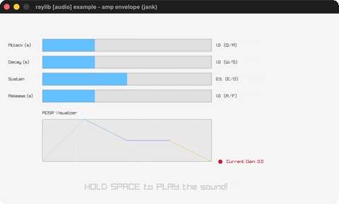

### [mixed-processor](https://github.com/b12n-oss/raylib-jank-demo/tree/main/mixed-processor)

A DSP distortion callback on the whole audio mix. Controls: LEFT/RIGHT distortion, SPACE coin, ESC. Run it with `bb mixed-processor`.

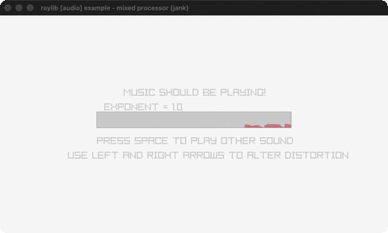

### [module-playing](https://github.com/b12n-oss/raylib-jank-demo/tree/main/module-playing)

A chiptune XM module + pulsing circle waves. Controls: SPACE restart · P pause · U/D pitch · Q quit. Run it with `bb module-playing`.

### [music-stream](https://github.com/b12n-oss/raylib-jank-demo/tree/main/music-stream)

Stream an MP3 with pan/volume/progress controls. Controls: SPACE restart · P pause · L/R pan · U/D volume · Q. Run it with `bb music-stream`.

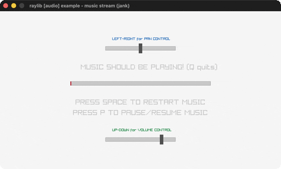

### [raw-stream](https://github.com/b12n-oss/raylib-jank-demo/tree/main/raw-stream)

A sine wave generated sample-by-sample into a stream. Controls: UP/DOWN frequency, LEFT/RIGHT pan, ESC. Run it with `bb raw-stream`.

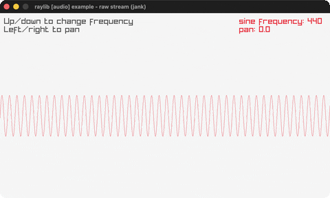

### [sound-loading](https://github.com/b12n-oss/raylib-jank-demo/tree/main/sound-loading)

Play a WAV and an OGG sound. Controls: SPACE wav · ENTER ogg · Q quit. Run it with `bb sound-loading`.

### [sound-multi](https://github.com/b12n-oss/raylib-jank-demo/tree/main/sound-multi)

Overlapping sound playback via sound aliases. Controls: SPACE play (rapid = overlap) · Q quit. Run it with `bb sound-multi`.

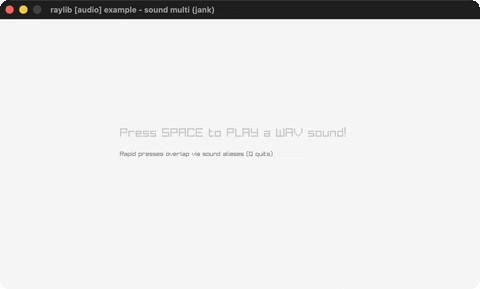

### [sound-positioning](https://github.com/b12n-oss/raylib-jank-demo/tree/main/sound-positioning)

Spatial audio around an orbiting 3D sphere. Controls: listen! · Q quit. Run it with `bb sound-positioning`.

### [spectrum-visualizer](https://github.com/b12n-oss/raylib-jank-demo/tree/main/spectrum-visualizer)

A live FFT spectrum of the music through a shader. Controls: ESC. Run it with `bb spectrum-visualizer`.

### [stream-callback](https://github.com/b12n-oss/raylib-jank-demo/tree/main/stream-callback)

A pull-model synth: sine/square/triangle/sawtooth on demand. Controls: LEFT/RIGHT wave, UP/DOWN frequency, ESC. Run it with `bb stream-callback`.

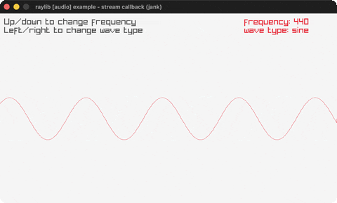

### [stream-effects](https://github.com/b12n-oss/raylib-jank-demo/tree/main/stream-effects)

Stackable lowpass + delay effects on one music stream. Controls: F lowpass, D delay, SPACE restart, P pause, ESC. Run it with `bb stream-effects`.

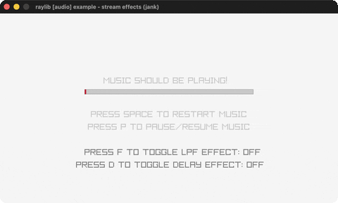

## core (47)

### [automation-events](https://github.com/b12n-oss/raylib-jank-demo/tree/main/automation-events)

A platformer recording and replaying its own input. Controls: LEFT/RIGHT move, SPACE jump, R reset, S record, A replay, ESC. Run it with `bb automation-events`.

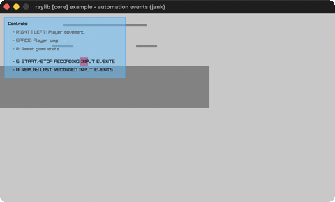

### [basic-screen-manager](https://github.com/b12n-oss/raylib-jank-demo/tree/main/basic-screen-manager)

A LOGO/TITLE/GAMEPLAY/ENDING flow. Controls: ENTER advance · Q quit. Run it with `bb basic-screen-manager`.

### [basic-window](https://github.com/b12n-oss/raylib-jank-demo/tree/main/basic-window)

The minimal raylib window + text. Controls: Q quit. Run it with `bb basic-window`.

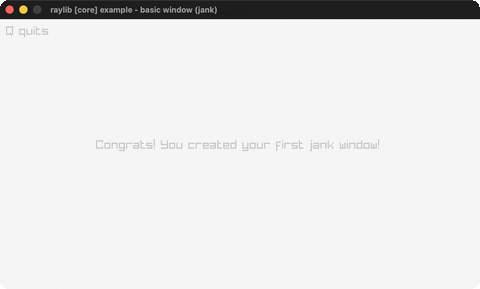

### [camera-2d](https://github.com/b12n-oss/raylib-jank-demo/tree/main/camera-2d)

A free 2D camera over a skyline. Controls: arrows move · WHEEL zoom · A/S rotate · R reset · Q. Run it with `bb camera-2d`.

### [camera-2d-mouse-zoom](https://github.com/b12n-oss/raylib-jank-demo/tree/main/camera-2d-mouse-zoom)

Pan + zoom-to-cursor a 2D camera. Controls: 1/2 mode · LEFT drag · WHEEL/RIGHT zoom · Q. Run it with `bb camera-2d-mouse-zoom`.

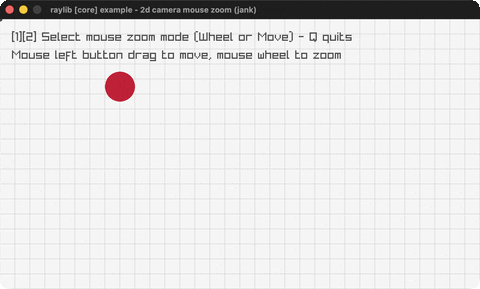

### [camera-2d-platformer](https://github.com/b12n-oss/raylib-jank-demo/tree/main/camera-2d-platformer)

A platformer with 5 camera-follow modes. Controls: LEFT/RIGHT move · SPACE jump · WHEEL zoom · C camera · R reset · Q quit. Run it with `bb camera-2d-platformer`.

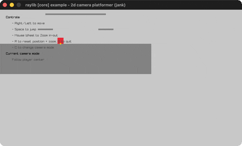

### [camera-2d-split-screen](https://github.com/b12n-oss/raylib-jank-demo/tree/main/camera-2d-split-screen)

Two players, two cameras, split screen. Controls: W/S/A/D player 1 · ARROWS player 2 · Q quit. Run it with `bb camera-2d-split-screen`.

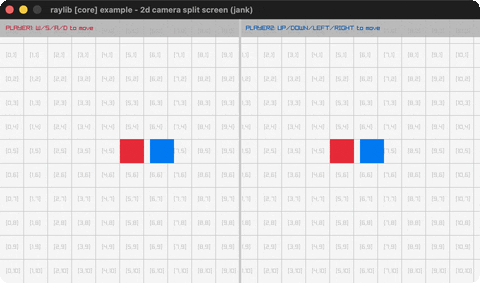

### [camera-3d](https://github.com/b12n-oss/raylib-jank-demo/tree/main/camera-3d)

A red cube on a grid through a fixed 3D camera. Controls: watch · Q quit. Run it with `bb camera-3d`.

### [camera-3d-first-person](https://github.com/b12n-oss/raylib-jank-demo/tree/main/camera-3d-first-person)

Walk a yard of random columns in first person. Controls: WASD + mouse, 1-4 camera mode, P projection, ESC. Run it with `bb camera-3d-first-person`.

### [camera-3d-fps](https://github.com/b12n-oss/raylib-jank-demo/tree/main/camera-3d-fps)

A physics FPS controller with head-bob and lean. Controls: WASD move, SPACE jump, Left-Ctrl crouch, mouse look, ESC. Run it with `bb camera-3d-fps`.

### [camera-3d-free](https://github.com/b12n-oss/raylib-jank-demo/tree/main/camera-3d-free)

A free-look 3D camera around a cube. Controls: mouse look, WHEEL zoom, wheel-press pan, Z retarget, ESC. Run it with `bb camera-3d-free`.

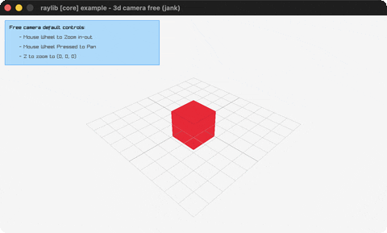

### [camera-3d-split-screen](https://github.com/b12n-oss/raylib-jank-demo/tree/main/camera-3d-split-screen)

Two players, two 3D cameras, split screen. Controls: W/S player 1, UP/DOWN player 2, ESC. Run it with `bb camera-3d-split-screen`.

### [clipboard-text](https://github.com/b12n-oss/raylib-jank-demo/tree/main/clipboard-text)

Type + cut/copy/paste with the system clipboard. Controls: type, CTRL+X/C/V/R/D, ESC. Run it with `bb clipboard-text`.

### [compute-hash](https://github.com/b12n-oss/raylib-jank-demo/tree/main/compute-hash)

CRC32/MD5/SHA1/SHA256 + Base64 of typed text. Controls: type, BACKSPACE delete, ENTER compute, ESC. Run it with `bb compute-hash`.

### [custom-logging](https://github.com/b12n-oss/raylib-jank-demo/tree/main/custom-logging)

A trace-log callback timestamps every raylib line. Controls: watch the console, ESC. Run it with `bb custom-logging`.

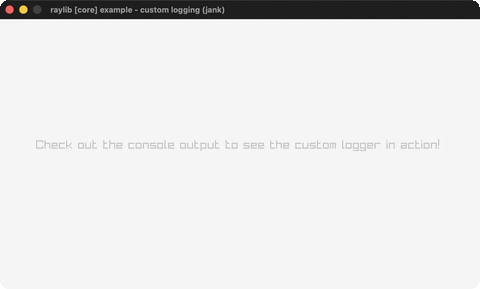

### [delta-time](https://github.com/b12n-oss/raylib-jank-demo/tree/main/delta-time)

Delta-time vs per-frame movement. Controls: WHEEL fps · R reset · Q. Run it with `bb delta-time`.

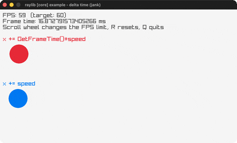

### [directory-files](https://github.com/b12n-oss/raylib-jank-demo/tree/main/directory-files)

A keyboard file browser over the working directory. Controls: UP/DOWN select, ENTER open dir, BACKSPACE up, ESC. Run it with `bb directory-files`.

### [drop-files](https://github.com/b12n-oss/raylib-jank-demo/tree/main/drop-files)

Drag files onto the window to list their paths. Controls: drag & drop files, ESC. Run it with `bb drop-files`.

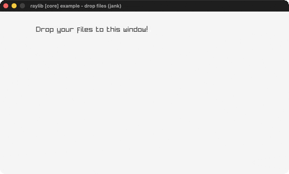

### [highdpi-demo](https://github.com/b12n-oss/raylib-jank-demo/tree/main/highdpi-demo)

Logical-points vs physical-pixels grids with live DPI scale. Controls: resize window · N next monitor · ESC. Run it with `bb highdpi-demo`.

### [highdpi-testbed](https://github.com/b12n-oss/raylib-jank-demo/tree/main/highdpi-testbed)

A HighDPI overlay: grid, monitor/DPI info, crosshair. Controls: SPACE borderless · F fullscreen · ESC. Run it with `bb highdpi-testbed`.

### [input-actions](https://github.com/b12n-oss/raylib-jank-demo/tree/main/input-actions)

Remappable abstract actions (WASD/arrows) via a keyset map. Controls: WASD/arrows move · SPACE fire · TAB swap keyset · ESC. Run it with `bb input-actions`.

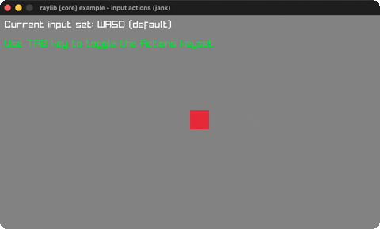

### [input-gamepad](https://github.com/b12n-oss/raylib-jank-demo/tree/main/input-gamepad)

A live controller diagram: buttons/sticks/triggers lit. Controls: plug in a gamepad, LEFT/RIGHT switch slot, click VIBRATE, ESC. Run it with `bb input-gamepad`.

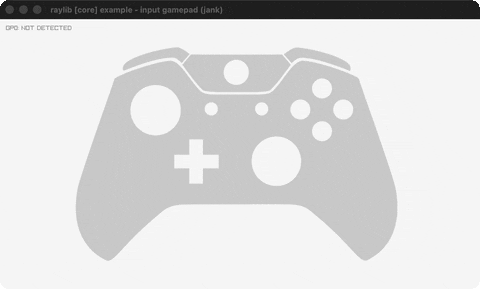

### [input-gestures](https://github.com/b12n-oss/raylib-jank-demo/tree/main/input-gestures)

Log detected mouse/touch gestures. Controls: tap/drag/swipe in the area · Q quit. Run it with `bb input-gestures`.

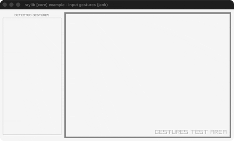

### [input-gestures-testbed](https://github.com/b12n-oss/raylib-jank-demo/tree/main/input-gestures-testbed)

A gesture dashboard with log, indicators and protractor. Controls: tap/drag/swipe with the mouse, click Hide buttons, ESC. Run it with `bb input-gestures-testbed`.

### [input-keys](https://github.com/b12n-oss/raylib-jank-demo/tree/main/input-keys)

Steer a ball with the arrow keys. Controls: ARROWS · Q quit. Run it with `bb input-keys`.

### [input-mouse](https://github.com/b12n-oss/raylib-jank-demo/tree/main/input-mouse)

A ball follows the mouse; click to recolor. Controls: mouse · LEFT/MIDDLE/RIGHT · Q. Run it with `bb input-mouse`.

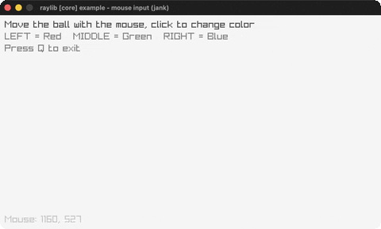

### [input-mouse-wheel](https://github.com/b12n-oss/raylib-jank-demo/tree/main/input-mouse-wheel)

Scroll a box with the mouse wheel. Controls: WHEEL · Q quit. Run it with `bb input-mouse-wheel`.

### [input-multitouch](https://github.com/b12n-oss/raylib-jank-demo/tree/main/input-multitouch)

A ball at every active touch/mouse point. Controls: touch/click · Q quit. Run it with `bb input-multitouch`.

### [input-virtual-controls](https://github.com/b12n-oss/raylib-jank-demo/tree/main/input-virtual-controls)

An on-screen D-pad moving a player circle. Controls: hold LEFT on a button · Q quit. Run it with `bb input-virtual-controls`.

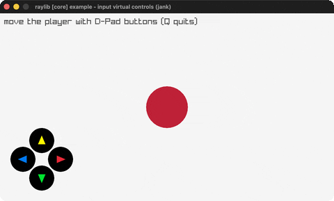

### [keyboard-testbed](https://github.com/b12n-oss/raylib-jank-demo/tree/main/keyboard-testbed)

An on-screen ENG-US keyboard highlighting held keys. Controls: hold any keys, mouse hover; close window to quit. Run it with `bb keyboard-testbed`.

### [monitor-detector](https://github.com/b12n-oss/raylib-jank-demo/tree/main/monitor-detector)

A scaled map of every attached monitor with its specs. Controls: ENTER next monitor · ESC. Run it with `bb monitor-detector`.

### [picking-3d](https://github.com/b12n-oss/raylib-jank-demo/tree/main/picking-3d)

Click a 3D box to pick it with a world-space ray. Controls: LEFT click box · Q quit. Run it with `bb picking-3d`.

### [random-sequence](https://github.com/b12n-oss/raylib-jank-demo/tree/main/random-sequence)

Colored bars in a no-repeat LoadRandomSequence. Controls: SPACE shuffle, UP/DOWN count, ESC. Run it with `bb random-sequence`.

### [random-values](https://github.com/b12n-oss/raylib-jank-demo/tree/main/random-values)

A new random value every two seconds. Controls: Q quit. Run it with `bb random-values`.

### [render-texture](https://github.com/b12n-oss/raylib-jank-demo/tree/main/render-texture)

A ball bouncing inside a rotated off-screen render texture. Controls: ESC. Run it with `bb render-texture`.

### [scissor-test](https://github.com/b12n-oss/raylib-jank-demo/tree/main/scissor-test)

A scissor rectangle reveals text. Controls: mouse · S toggle · Q quit. Run it with `bb scissor-test`.

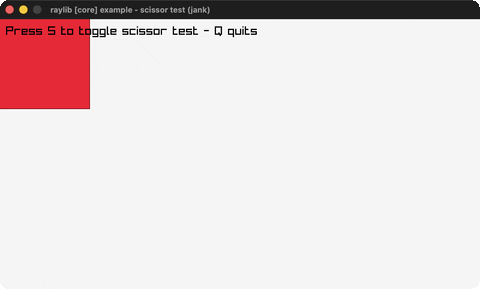

### [screen-recording](https://github.com/b12n-oss/raylib-jank-demo/tree/main/screen-recording)

Record the window to an animated GIF. Controls: CTRL+R start/stop, Q. Run it with `bb screen-recording`.

### [smooth-pixelperfect](https://github.com/b12n-oss/raylib-jank-demo/tree/main/smooth-pixelperfect)

Sub-pixel smoothing of upscaled pixel art. Controls: S smooth · O overscan · Q quit. Run it with `bb smooth-pixelperfect`.

### [storage-values](https://github.com/b12n-oss/raylib-jank-demo/tree/main/storage-values)

Save/load a score pair to a binary storage file. Controls: R random, ENTER save, SPACE load, ESC. Run it with `bb storage-values`.

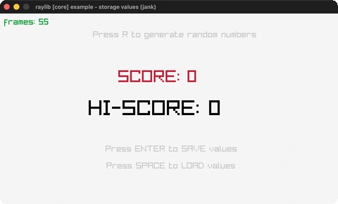

### [text-file-loading](https://github.com/b12n-oss/raylib-jank-demo/tree/main/text-file-loading)

Load + word-wrap a text file, scroll it. Controls: mouse wheel scroll, ESC. Run it with `bb text-file-loading`.

### [undo-redo](https://github.com/b12n-oss/raylib-jank-demo/tree/main/undo-redo)

A grid player with a 26-slot undo/redo ring buffer. Controls: ARROWS move, SPACE color, CTRL+Z/Y undo/redo, ESC. Run it with `bb undo-redo`.

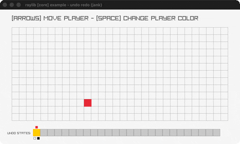

### [viewport-scaling](https://github.com/b12n-oss/raylib-jank-demo/tree/main/viewport-scaling)

A fixed game resolution scaled into a resizable window. Controls: resize window, click < > buttons, ESC. Run it with `bb viewport-scaling`.

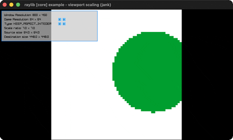

### [vr-simulator](https://github.com/b12n-oss/raylib-jank-demo/tree/main/vr-simulator)

A 3D scene in stereo through a simulated Oculus Rift. Controls: mouse look (first-person), ESC. Run it with `bb vr-simulator`.

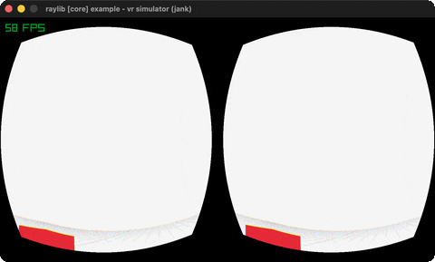

### [window-flags](https://github.com/b12n-oss/raylib-jank-demo/tree/main/window-flags)

Toggle window state flags live with a bouncing ball. Controls: F/R/D/H/N/M/U/T/A/V/B toggle flags · ESC. Run it with `bb window-flags`.

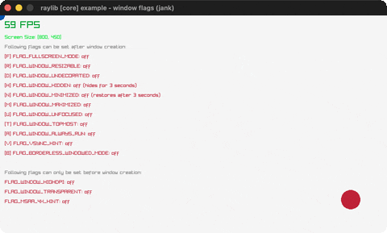

### [window-letterbox](https://github.com/b12n-oss/raylib-jank-demo/tree/main/window-letterbox)

A fixed 640x480 game letterboxed on resize. Controls: resize the window · SPACE recolor · Q quit. Run it with `bb window-letterbox`.

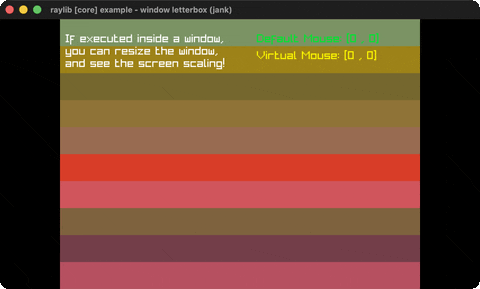

### [window-should-close](https://github.com/b12n-oss/raylib-jank-demo/tree/main/window-should-close)

Confirm-before-exit on window close. Controls: ESC/X then Y/N · Q. Run it with `bb window-should-close`.

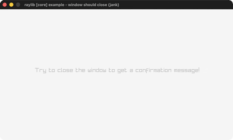

### [world-screen](https://github.com/b12n-oss/raylib-jank-demo/tree/main/world-screen)

A 2D label tracking a 3D cube (GetWorldToScreen). Controls: watch · Q quit. Run it with `bb world-screen`.

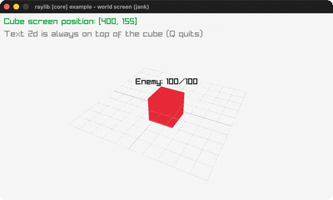

## interop (1)

### [opaque-boxes](https://github.com/b12n-oss/raylib-jank-demo/tree/main/opaque-boxes)

Native Colors carried across fns in opaque boxes. Controls: SPACE cycles · Q quit. Run it with `bb opaque-boxes`.

## models (29)

### [animation-blend-custom](https://github.com/b12n-oss/raylib-jank-demo/tree/main/animation-blend-custom)

Per-bone blending: walking legs + attacking upper body. Controls: SPACE toggle blend mode, ESC. Run it with `bb animation-blend-custom`.

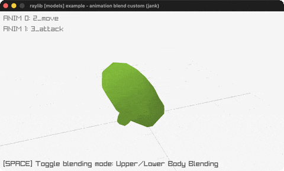

### [animation-blending](https://github.com/b12n-oss/raylib-jank-demo/tree/main/animation-blending)

SPACE cross-fades the robot between two animations. Controls: SPACE blend, LEFT/RIGHT + UP/DOWN anims, Z/X + N/M speeds, P, ESC. Run it with `bb animation-blending`.

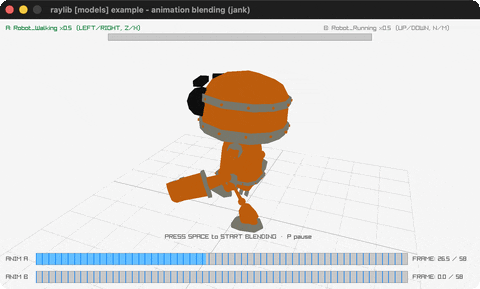

### [animation-timing](https://github.com/b12n-oss/raylib-jank-demo/tree/main/animation-timing)

The robot with a playback timeline + adjustable speed. Controls: LEFT/RIGHT anim, UP/DOWN speed, P pause, ESC. Run it with `bb animation-timing`.

### [basic-voxel](https://github.com/b12n-oss/raylib-jank-demo/tree/main/basic-voxel)

An 8x8x8 voxel grid; click to ray-pick and remove. Controls: LEFT/RIGHT spin, click remove, R refill, ESC. Run it with `bb basic-voxel`.

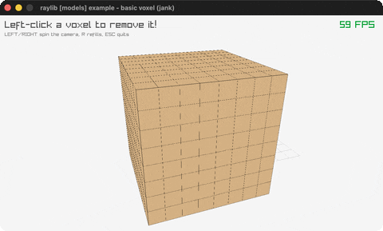

### [billboard-rendering](https://github.com/b12n-oss/raylib-jank-demo/tree/main/billboard-rendering)

Camera-facing billboards + an orbiting camera. Controls: watch · Q quit. Run it with `bb billboard-rendering`.

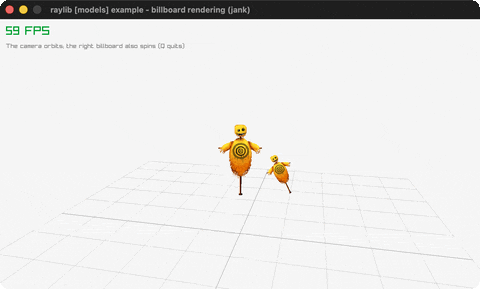

### [bone-socket](https://github.com/b12n-oss/raylib-jank-demo/tree/main/bone-socket)

A hat, sword and shield riding the greenman's bones. Controls: T/G anim, F/H rotate, 1/2/3 equip, ESC. Run it with `bb bone-socket`.

### [box-collisions](https://github.com/b12n-oss/raylib-jank-demo/tree/main/box-collisions)

A player cube colliding with 3D obstacles. Controls: ARROWS move · Q quit. Run it with `bb box-collisions`.

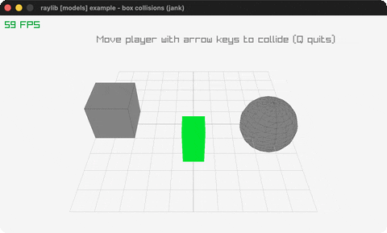

### [cubicmap-rendering](https://github.com/b12n-oss/raylib-jank-demo/tree/main/cubicmap-rendering)

A cube maze generated from a tiny black-and-white image. Controls: P pause orbit, ESC. Run it with `bb cubicmap-rendering`.

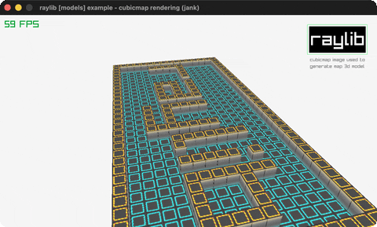

### [decals](https://github.com/b12n-oss/raylib-jank-demo/tree/main/decals)

Click to splat logo decals onto a character's surface. Controls: CLICK splat, RMB-hold camera, H model, C clear, ESC. Run it with `bb decals`.

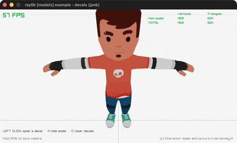

### [directional-billboard](https://github.com/b12n-oss/raylib-jank-demo/tree/main/directional-billboard)

A sprite-sheet billboard that turns as the camera orbits. Controls: ESC. Run it with `bb directional-billboard`.

### [first-person-maze](https://github.com/b12n-oss/raylib-jank-demo/tree/main/first-person-maze)

Walk a cubicmap maze in first person, with a radar. Controls: WASD + mouse look, ESC. Run it with `bb first-person-maze`.

### [geometric-shapes](https://github.com/b12n-oss/raylib-jank-demo/tree/main/geometric-shapes)

3D cubes/spheres/cylinders/capsules on a grid. Controls: Q quit. Run it with `bb geometric-shapes`.

### [heightmap-rendering](https://github.com/b12n-oss/raylib-jank-demo/tree/main/heightmap-rendering)

Terrain generated from a grayscale heightmap image. Controls: ESC. Run it with `bb heightmap-rendering`.

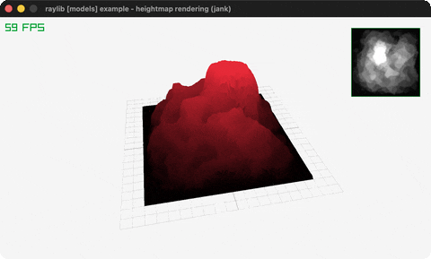

### [loading-gltf](https://github.com/b12n-oss/raylib-jank-demo/tree/main/loading-gltf)

The animated glTF robot, switchable animations. Controls: LEFT/RIGHT animation, ESC. Run it with `bb loading-gltf`.

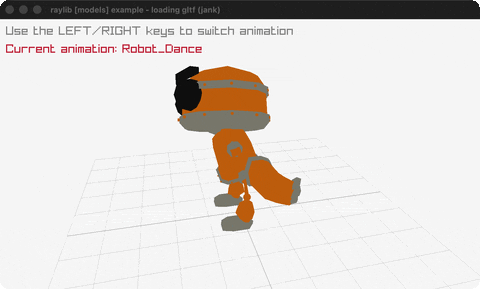

### [loading-iqm](https://github.com/b12n-oss/raylib-jank-demo/tree/main/loading-iqm)

The classic IQM guy walking on loop. Controls: ESC. Run it with `bb loading-iqm`.

### [loading-m3d](https://github.com/b12n-oss/raylib-jank-demo/tree/main/loading-m3d)

The Cesium Man in Model3D format, skeleton view on SPACE. Controls: LEFT/RIGHT animation, hold SPACE skeleton, ESC. Run it with `bb loading-m3d`.

### [loading-vox](https://github.com/b12n-oss/raylib-jank-demo/tree/main/loading-vox)

Four MagicaVoxel models under a fly camera + voxel lighting. Controls: CLICK cycle, WASD/ARROWS move, MIDDLE-drag rotate, WHEEL zoom, ESC. Run it with `bb loading-vox`.

### [mesh-generation](https://github.com/b12n-oss/raylib-jank-demo/tree/main/mesh-generation)

All nine procedural mesh generators, checked-textured. Controls: CLICK or LEFT/RIGHT cycle, ESC. Run it with `bb mesh-generation`.

### [mesh-picking](https://github.com/b12n-oss/raylib-jank-demo/tree/main/mesh-picking)

A mouse ray picks the closest quad/sphere/box/mesh. Controls: mouse aim, RIGHT CLICK camera, ESC. Run it with `bb mesh-picking`.

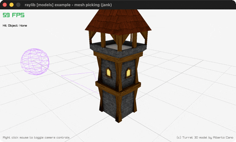

### [model-loading](https://github.com/b12n-oss/raylib-jank-demo/tree/main/model-loading)

The castle OBJ model loaded from disk, ray-pick selection. Controls: LEFT CLICK select, ESC. Run it with `bb model-loading`.

### [orthographic-projection](https://github.com/b12n-oss/raylib-jank-demo/tree/main/orthographic-projection)

Toggle perspective vs orthographic camera. Controls: SPACE toggle · Q quit. Run it with `bb orthographic-projection`.

### [point-rendering](https://github.com/b12n-oss/raylib-jank-demo/tree/main/point-rendering)

Up to 10 million points: GPU point mode vs per-point draws. Controls: UP/DOWN count, SPACE method, ESC. Run it with `bb point-rendering`.

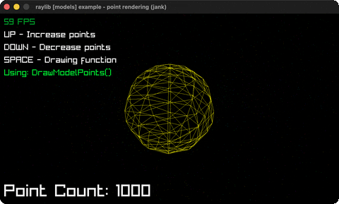

### [rlgl-solar-system](https://github.com/b12n-oss/raylib-jank-demo/tree/main/rlgl-solar-system)

Sun/Earth/Moon via the rlgl matrix stack. Controls: watch · Q quit. Run it with `bb rlgl-solar-system`.

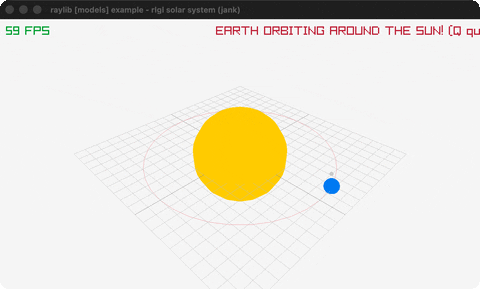

### [rotating-cube](https://github.com/b12n-oss/raylib-jank-demo/tree/main/rotating-cube)

A textured cube spinning on a tilted axis (rlgl). Controls: ESC. Run it with `bb rotating-cube`.

### [skybox-rendering](https://github.com/b12n-oss/raylib-jank-demo/tree/main/skybox-rendering)

A cubemap skybox drawn from inside a unit cube. Controls: WASD + mouse look, ESC. Run it with `bb skybox-rendering`.

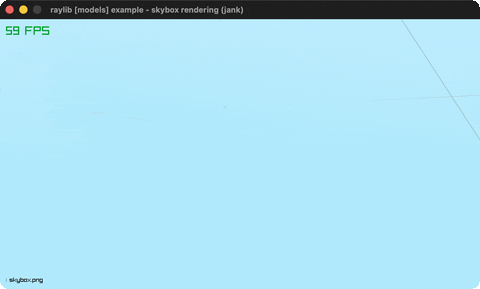

### [tesseract-view](https://github.com/b12n-oss/raylib-jank-demo/tree/main/tesseract-view)

A rotating 4D hypercube projected to 3D. Controls: watch · Q quit. Run it with `bb tesseract-view`.

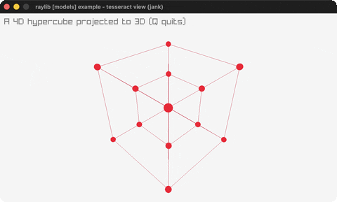

### [textured-cube](https://github.com/b12n-oss/raylib-jank-demo/tree/main/textured-cube)

Two rlgl textured 3D cubes from a shared atlas. Controls: ESC. Run it with `bb textured-cube`.

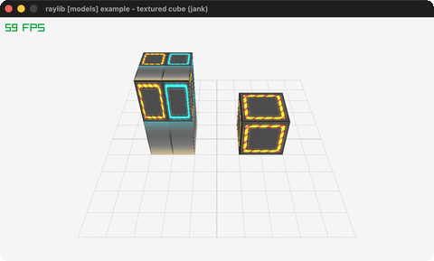

### [waving-cubes](https://github.com/b12n-oss/raylib-jank-demo/tree/main/waving-cubes)

3375 rainbow cubes waving in 3D. Controls: watch · Q quit. Run it with `bb waving-cubes`.

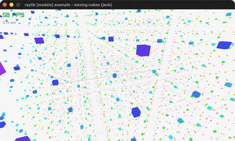

### [yaw-pitch-roll](https://github.com/b12n-oss/raylib-jank-demo/tree/main/yaw-pitch-roll)

Fly a WWI plane through pitch/yaw/roll, easing level. Controls: UP/DOWN pitch, LEFT/RIGHT roll, A/S yaw, ESC. Run it with `bb yaw-pitch-roll`.

## others (1)

### [embedded-files](https://github.com/b12n-oss/raylib-jank-demo/tree/main/embedded-files)

A logo and a sound compiled into the binary as C arrays. Controls: SPACE plays the sound, Q. Run it with `bb embedded-files`.

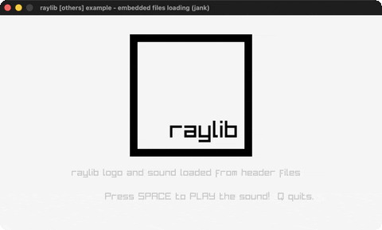

## shaders (35)

### [ascii-rendering](https://github.com/b12n-oss/raylib-jank-demo/tree/main/ascii-rendering)

A shader re-rendering the scene as ASCII glyphs. Controls: LEFT/RIGHT cell size, ESC. Run it with `bb ascii-rendering`.

### [basic-lighting](https://github.com/b12n-oss/raylib-jank-demo/tree/main/basic-lighting)

A plane + cube lit by four toggleable colored point lights. Controls: Y/R/G/B toggle lights, ESC. Run it with `bb basic-lighting`.

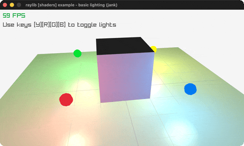

### [basic-pbr](https://github.com/b12n-oss/raylib-jank-demo/tree/main/basic-pbr)

The rusty car under physically-based rendering (PBR maps). Controls: 1-4 toggle lights, ESC. Run it with `bb basic-pbr`.

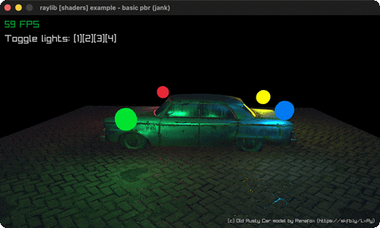

### [cel-shading](https://github.com/b12n-oss/raylib-jank-demo/tree/main/cel-shading)

A GLB car toon-shaded with quantized bands + outline. Controls: Z cel, C outline, Q/E bands, ESC. Run it with `bb cel-shading`.

### [color-correction](https://github.com/b12n-oss/raylib-jank-demo/tree/main/color-correction)

A shader tuning contrast/saturation/brightness. Controls: 1-4 picture, Q/W A/S Z/X sliders, R reset, ESC. Run it with `bb color-correction`.

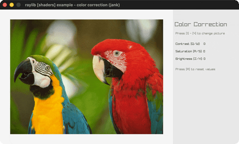

### [custom-uniform](https://github.com/b12n-oss/raylib-jank-demo/tree/main/custom-uniform)

A mouse-steered swirl over a render-textured scene. Controls: move the mouse, ESC. Run it with `bb custom-uniform`.

### [deferred-rendering](https://github.com/b12n-oss/raylib-jank-demo/tree/main/deferred-rendering)

A three-target G-buffer + deferred lighting pass. Controls: Y/R/G/B lights, 1-4 views, ESC. Run it with `bb deferred-rendering`.

### [depth-rendering](https://github.com/b12n-oss/raylib-jank-demo/tree/main/depth-rendering)

The scene's depth buffer visualized through a shader. Controls: WASD + mouse look, Z retarget, ESC. Run it with `bb depth-rendering`.

### [depth-writing](https://github.com/b12n-oss/raylib-jank-demo/tree/main/depth-writing)

Inverted gl_FragDepth into a custom depth texture. Controls: ESC. Run it with `bb depth-writing`.

### [eratosthenes-sieve](https://github.com/b12n-oss/raylib-jank-demo/tree/main/eratosthenes-sieve)

The Sieve of Eratosthenes per-pixel in a shader. Controls: ESC. Run it with `bb eratosthenes-sieve`.

### [fog-rendering](https://github.com/b12n-oss/raylib-jank-demo/tree/main/fog-rendering)

Torus/cube/sphere models fading into exponential fog. Controls: UP/DOWN fog density, ESC. Run it with `bb fog-rendering`.

### [game-of-life](https://github.com/b12n-oss/raylib-jank-demo/tree/main/game-of-life)

Conway's Life on a 2048x2048 world: pan/zoom, presets. Controls: 1-9/0 presets, R/P/D mode, Z/X zoom, F/S speed, drag pan, ESC. Run it with `bb game-of-life`.

### [hot-reloading](https://github.com/b12n-oss/raylib-jank-demo/tree/main/hot-reloading)

Hot-swap the reload.fs fragment shader while it runs. Controls: A auto-reload, CLICK reload once, ESC. Run it with `bb hot-reloading`.

### [hybrid-rendering](https://github.com/b12n-oss/raylib-jank-demo/tree/main/hybrid-rendering)

Raymarched spheres + rasterized cubes, depth-tested. Controls: ESC. Run it with `bb hybrid-rendering`.

### [julia-set](https://github.com/b12n-oss/raylib-jank-demo/tree/main/julia-set)

A Julia set fractal computed in a fragment shader. Controls: mouse zoom/drift, 1-6 presets, LEFT/RIGHT speed, SPACE, R, F1, ESC. Run it with `bb julia-set`.

### [lightmap-rendering](https://github.com/b12n-oss/raylib-jank-demo/tree/main/lightmap-rendering)

A plane lit by a baked lightmap through a second UV channel. Controls: ESC. Run it with `bb lightmap-rendering`.

### [mandelbrot-set](https://github.com/b12n-oss/raylib-jank-demo/tree/main/mandelbrot-set)

The Mandelbrot set in a shader, deep-zoom presets. Controls: mouse zoom/drift, 1-6 presets, UP/DOWN iterations, R, F1, ESC. Run it with `bb mandelbrot-set`.

### [mesh-instancing](https://github.com/b12n-oss/raylib-jank-demo/tree/main/mesh-instancing)

Ten thousand lit cubes in one draw call (DrawMeshInstanced). Controls: ESC. Run it with `bb mesh-instancing`.

### [model-shader](https://github.com/b12n-oss/raylib-jank-demo/tree/main/model-shader)

The watermill OBJ drawn grayscale by a material shader. Controls: WASD + mouse look, ESC. Run it with `bb model-shader`.

### [multi-sample2d](https://github.com/b12n-oss/raylib-jank-demo/tree/main/multi-sample2d)

Two textures blended in a shader via a second sampler2D. Controls: LEFT/RIGHT divider, ESC. Run it with `bb multi-sample2d`.

### [normalmap-rendering](https://github.com/b12n-oss/raylib-jank-demo/tree/main/normalmap-rendering)

A spinning plane lit through a tangent-space normal map. Controls: N toggle, WASD light, UP/DOWN shininess, ESC. Run it with `bb normalmap-rendering`.

### [palette-switch](https://github.com/b12n-oss/raylib-jank-demo/tree/main/palette-switch)

Palette-indexed bands recolored by a shader uniform. Controls: LEFT/RIGHT palette, ESC. Run it with `bb palette-switch`.

### [postprocessing](https://github.com/b12n-oss/raylib-jank-demo/tree/main/postprocessing)

Twelve full-screen post-process shaders, cycled. Controls: LEFT/RIGHT cycle effect, ESC. Run it with `bb postprocessing`.

### [raymarching](https://github.com/b12n-oss/raylib-jank-demo/tree/main/raymarching)

A raymarched SDF scene with a first-person fly-cam. Controls: WASD move, mouse look, Q/E down/up, ESC. Run it with `bb raymarching`.

### [rlgl-compute](https://github.com/b12n-oss/raylib-jank-demo/tree/main/rlgl-compute)

Game of Life stepped entirely on the GPU by compute shaders. Controls: LEFT draw, RIGHT erase, WHEEL brush, ESC. Run it with `bb rlgl-compute`.

### [rounded-rectangle-shader](https://github.com/b12n-oss/raylib-jank-demo/tree/main/rounded-rectangle-shader)

SDF rounded rects (fill/shadow/border) in a shader. Controls: Q/ESC quit. Run it with `bb rounded-rectangle-shader`.

### [shadowmap-rendering](https://github.com/b12n-oss/raylib-jank-demo/tree/main/shadowmap-rendering)

Real shadows: an animated robot under a shadowmap. Controls: ARROWS light, F screenshot, ESC. Run it with `bb shadowmap-rendering`.

### [shapes-textures-shader](https://github.com/b12n-oss/raylib-jank-demo/tree/main/shapes-textures-shader)

A grayscale fragment shader over shapes + a sprite. Controls: ESC. Run it with `bb shapes-textures-shader`.

### [simple-mask](https://github.com/b12n-oss/raylib-jank-demo/tree/main/simple-mask)

An animated mask eats holes in two models' skin. Controls: WASD + mouse look, ESC. Run it with `bb simple-mask`.

### [spotlight-rendering](https://github.com/b12n-oss/raylib-jank-demo/tree/main/spotlight-rendering)

Three spotlights alpha-masked over a sprite swarm. Controls: move the mouse, ESC. Run it with `bb spotlight-rendering`.

### [texture-outline](https://github.com/b12n-oss/raylib-jank-demo/tree/main/texture-outline)

A shader-drawn outline around a sprite. Controls: mouse wheel outline size, ESC. Run it with `bb texture-outline`.

### [texture-rendering](https://github.com/b12n-oss/raylib-jank-demo/tree/main/texture-rendering)

A blank texture painted entirely by a fragment shader. Controls: ESC. Run it with `bb texture-rendering`.

### [texture-tiling](https://github.com/b12n-oss/raylib-jank-demo/tree/main/texture-tiling)

A cube model with its texture tiled 3x3 by a shader. Controls: WASD + mouse look, Z retarget, ESC. Run it with `bb texture-tiling`.

### [texture-waves](https://github.com/b12n-oss/raylib-jank-demo/tree/main/texture-waves)

A space texture rippled by an animated wave shader. Controls: ESC. Run it with `bb texture-waves`.

### [vertex-displacement](https://github.com/b12n-oss/raylib-jank-demo/tree/main/vertex-displacement)

A plane mesh riding Perlin-noise waves in the vertex shader. Controls: WASD + mouse look, ESC. Run it with `bb vertex-displacement`.

## shapes (41)

### [ball-physics](https://github.com/b12n-oss/raylib-jank-demo/tree/main/ball-physics)

Grab and throw balls under gravity. Controls: drag · RIGHT spawn · WHEEL gravity · MIDDLE shake · Q. Run it with `bb ball-physics`.

### [basic-shapes](https://github.com/b12n-oss/raylib-jank-demo/tree/main/basic-shapes)

A gallery of raylib's basic shapes. Controls: Q quit. Run it with `bb basic-shapes`.

### [bouncing-ball](https://github.com/b12n-oss/raylib-jank-demo/tree/main/bouncing-ball)

A ball bouncing with optional gravity. Controls: SPACE pause · G gravity · Q quit. Run it with `bb bouncing-ball`.

### [bullet-hell](https://github.com/b12n-oss/raylib-jank-demo/tree/main/bullet-hell)

A magic circle spraying bullet spirals. Controls: L/R rows · U/D speed · Z/X cooldown · SPACE angle · ENTER method · C clear · Q. Run it with `bb bullet-hell`.

### [circle-sector-drawing](https://github.com/b12n-oss/raylib-jank-demo/tree/main/circle-sector-drawing)

A circle sector with adjustable angles. Controls: L/R + U/D angles · A/S radius · O/P segments · Q quit. Run it with `bb circle-sector-drawing`.

### [clock-of-clocks](https://github.com/b12n-oss/raylib-jank-demo/tree/main/clock-of-clocks)

Digits drawn from grids of little clocks. Controls: SPACE 12/24h · Q quit. Run it with `bb clock-of-clocks`.

### [collision-area](https://github.com/b12n-oss/raylib-jank-demo/tree/main/collision-area)

AABB collision between a bouncing + mouse box. Controls: mouse · SPACE pause · Q. Run it with `bb collision-area`.

### [colors-palette](https://github.com/b12n-oss/raylib-jank-demo/tree/main/colors-palette)

Every named raylib color in a grid. Controls: mouse hover · SPACE all names · Q. Run it with `bb colors-palette`.

### [dashed-line](https://github.com/b12n-oss/raylib-jank-demo/tree/main/dashed-line)

A dashed line follows the mouse. Controls: ARROWS size · C color · Q quit. Run it with `bb dashed-line`.

### [digital-clock](https://github.com/b12n-oss/raylib-jank-demo/tree/main/digital-clock)

A live clock (digital + analogue modes). Controls: SPACE mode · Q quit. Run it with `bb digital-clock`.

### [double-pendulum](https://github.com/b12n-oss/raylib-jank-demo/tree/main/double-pendulum)

Chaotic double-pendulum motion + trail. Controls: Q quit. Run it with `bb double-pendulum`.

### [easings-ball](https://github.com/b12n-oss/raylib-jank-demo/tree/main/easings-ball)

A ball animated through easing stages. Controls: ENTER replay · R restart · Q quit. Run it with `bb easings-ball`.

### [easings-box](https://github.com/b12n-oss/raylib-jank-demo/tree/main/easings-box)

A box animated through five easing stages. Controls: SPACE reset · Q quit. Run it with `bb easings-box`.

### [easings-rectangles](https://github.com/b12n-oss/raylib-jank-demo/tree/main/easings-rectangles)

A grid shrinks and spins via easing fns. Controls: SPACE replay · Q quit. Run it with `bb easings-rectangles`.

### [easings-testbed](https://github.com/b12n-oss/raylib-jank-demo/tree/main/easings-testbed)

An interactive testbed for all 28 easings. Controls: ENTER play/pause · SPACE restart · L/R x-ease · U/D y-ease · Q/W A/S duration · T bounded · ESC quit. Run it with `bb easings-testbed`.

### [ellipse-collision](https://github.com/b12n-oss/raylib-jank-demo/tree/main/ellipse-collision)

Overlap test between two ellipses. Controls: mouse · A/B switch · Q quit. Run it with `bb ellipse-collision`.

### [following-eyes](https://github.com/b12n-oss/raylib-jank-demo/tree/main/following-eyes)

Two eyes track the mouse cursor. Controls: move the mouse · Q quit. Run it with `bb following-eyes`.

### [hilbert-curve](https://github.com/b12n-oss/raylib-jank-demo/tree/main/hilbert-curve)

A rainbow Hilbert space-filling curve. Controls: Z/X order · U/D size · L/R thickness · A animate · R redraw · Q. Run it with `bb hilbert-curve`.

### [kaleidoscope](https://github.com/b12n-oss/raylib-jank-demo/tree/main/kaleidoscope)

Draw strokes mirrored with 6-fold symmetry. Controls: LEFT mouse draw · L/R history · R reset · Q quit. Run it with `bb kaleidoscope`.

### [lines-bezier](https://github.com/b12n-oss/raylib-jank-demo/tree/main/lines-bezier)

Drag endpoints to reshape a Bezier curve. Controls: drag endpoints · Q quit. Run it with `bb lines-bezier`.

### [lines-drawing](https://github.com/b12n-oss/raylib-jank-demo/tree/main/lines-drawing)

A paint canvas (RenderTexture). Controls: LEFT paint · RIGHT erase · MIDDLE clear · WHEEL size · Q. Run it with `bb lines-drawing`.

### [logo-anim](https://github.com/b12n-oss/raylib-jank-demo/tree/main/logo-anim)

The raylib logo assembling itself. Controls: R replay · Q quit. Run it with `bb logo-anim`.

### [logo-raylib](https://github.com/b12n-oss/raylib-jank-demo/tree/main/logo-raylib)

The raylib logo from rectangles + text. Controls: Q quit. Run it with `bb logo-raylib`.

### [math-angle-rotation](https://github.com/b12n-oss/raylib-jank-demo/tree/main/math-angle-rotation)

Fixed-angle lines + a spinning line. Controls: Q quit. Run it with `bb math-angle-rotation`.

### [math-sine-cosine](https://github.com/b12n-oss/raylib-jank-demo/tree/main/math-sine-cosine)

A live unit-circle trig visualization. Controls: SPACE pause · L/R scrub angle · Q quit. Run it with `bb math-sine-cosine`.

### [mouse-trail](https://github.com/b12n-oss/raylib-jank-demo/tree/main/mouse-trail)

A fading trail follows the cursor. Controls: move the mouse · Q quit. Run it with `bb mouse-trail`.

### [particles](https://github.com/b12n-oss/raylib-jank-demo/tree/main/particles)

Water / smoke / fire particle effects. Controls: mouse · LEFT/RIGHT type · Q. Run it with `bb particles`.

### [penrose-tile](https://github.com/b12n-oss/raylib-jank-demo/tree/main/penrose-tile)

A Penrose tiling grown with an L-system. Controls: UP/DOWN generations · Q quit. Run it with `bb penrose-tile`.

### [pie-chart](https://github.com/b12n-oss/raylib-jank-demo/tree/main/pie-chart)

An interactive pie chart with hover pop. Controls: hover · Z/X slices · N/M select · L/R value · V/P/D toggles · A/S hole · Q. Run it with `bb pie-chart`.

### [rectangle-advanced](https://github.com/b12n-oss/raylib-jank-demo/tree/main/rectangle-advanced)

Rounded gradient rectangles via rlgl. Controls: Q quit. Run it with `bb rectangle-advanced`.

### [rectangle-scaling](https://github.com/b12n-oss/raylib-jank-demo/tree/main/rectangle-scaling)

Resize a rectangle by its corner. Controls: drag corner · Q quit. Run it with `bb rectangle-scaling`.

### [recursive-tree](https://github.com/b12n-oss/raylib-jank-demo/tree/main/recursive-tree)

A binary fractal tree with live knobs. Controls: L/R angle · U/D length · A/S decay · Z/X depth · T/Y thick · B bezier · Q. Run it with `bb recursive-tree`.

### [ring-drawing](https://github.com/b12n-oss/raylib-jank-demo/tree/main/ring-drawing)

A ring/annulus with adjustable angles. Controls: L/R + U/D angles · A/S Z/X radii · O/P segments · R/L/C toggles · Q. Run it with `bb ring-drawing`.

### [rlgl-color-wheel](https://github.com/b12n-oss/raylib-jank-demo/tree/main/rlgl-color-wheel)

An HSV color picker wheel via rlgl. Controls: click/drag pick · WHEEL count · U/D size · A/S value · SPACE wires · CTRL+C · Q. Run it with `bb rlgl-color-wheel`.

### [rlgl-triangle](https://github.com/b12n-oss/raylib-jank-demo/tree/main/rlgl-triangle)

A rainbow triangle via rlgl immediate mode. Controls: drag corners · SPACE lines · L/R culling · R reset · Q. Run it with `bb rlgl-triangle`.

### [rounded-rectangle](https://github.com/b12n-oss/raylib-jank-demo/tree/main/rounded-rectangle)

A rounded rectangle, size/roundness knobs. Controls: A/S Z/X size · L/R roundness · U/D thickness · O/P segments · R/L/G · Q. Run it with `bb rounded-rectangle`.

### [splines-drawing](https://github.com/b12n-oss/raylib-jank-demo/tree/main/splines-drawing)

Draggable spline points, 4 spline types. Controls: 1-4 type · LEFT drag · RIGHT add · A/S thickness · H helpers · Q. Run it with `bb splines-drawing`.

### [starfield](https://github.com/b12n-oss/raylib-jank-demo/tree/main/starfield)

A perspective starfield flying at you. Controls: MOUSE WHEEL · SPACE mode · Q. Run it with `bb starfield`.

### [top-down-lights](https://github.com/b12n-oss/raylib-jank-demo/tree/main/top-down-lights)

2D lights casting shadow volumes off boxes. Controls: drag light 1 · RIGHT add light · L debug view · Q quit. Run it with `bb top-down-lights`.

### [triangle-strip](https://github.com/b12n-oss/raylib-jank-demo/tree/main/triangle-strip)

A rainbow triangle-strip fan. Controls: L/R segments · O outline · Q quit. Run it with `bb triangle-strip`.

### [vector-angle](https://github.com/b12n-oss/raylib-jank-demo/tree/main/vector-angle)

Two ways to measure an angle. Controls: mouse · SPACE mode · RIGHT move · Q. Run it with `bb vector-angle`.

## text (16)

### [codepoints-loading](https://github.com/b12n-oss/raylib-jank-demo/tree/main/codepoints-loading)

Japanese text rasterized to a minimal TTF font atlas. Controls: SPACE toggle atlas view, ESC. Run it with `bb codepoints-loading`.

### [font-filters](https://github.com/b12n-oss/raylib-jank-demo/tree/main/font-filters)

Scale a TTF word, switch texture filters. Controls: WHEEL size · 1/2/3 filter · L/R move · Q. Run it with `bb font-filters`.

### [font-loading](https://github.com/b12n-oss/raylib-jank-demo/tree/main/font-loading)

Load a BMFont and a TTF font (DrawTextEx). Controls: SPACE = TTF · Q quit. Run it with `bb font-loading`.

### [font-sdf](https://github.com/b12n-oss/raylib-jank-demo/tree/main/font-sdf)

Bitmap vs SDF font scaling, the SDF drawn through a shader. Controls: MOUSE WHEEL scale, hold SPACE for SDF, ESC. Run it with `bb font-sdf`.

### [font-spritefont](https://github.com/b12n-oss/raylib-jank-demo/tree/main/font-spritefont)

Three colored sprite fonts from PNG atlases. Controls: watch · Q quit. Run it with `bb font-spritefont`.

### [format-text](https://github.com/b12n-oss/raylib-jank-demo/tree/main/format-text)

Zero-padded score/time text readouts. Controls: Q quit. Run it with `bb format-text`.

### [inline-styling](https://github.com/b12n-oss/raylib-jank-demo/tree/main/inline-styling)

Text with inline color style tags. Controls: watch the colors re-roll, ESC. Run it with `bb inline-styling`.

### [input-box](https://github.com/b12n-oss/raylib-jank-demo/tree/main/input-box)

A hover-to-type text input box. Controls: hover + type · BACKSPACE delete · Q (outside box) quit. Run it with `bb input-box`.

### [rectangle-bounds](https://github.com/b12n-oss/raylib-jank-demo/tree/main/rectangle-bounds)

Word-wrapped text in a mouse-resizable container. Controls: drag corner to resize, SPACE toggle wrap, ESC. Run it with `bb rectangle-bounds`.

### [sprite-fonts](https://github.com/b12n-oss/raylib-jank-demo/tree/main/sprite-fonts)

A gallery of raylib's eight bundled sprite fonts. Controls: watch · Q quit. Run it with `bb sprite-fonts`.

### [strings-management](https://github.com/b12n-oss/raylib-jank-demo/tree/main/strings-management)

Drag/slice/shatter/glue text; 1-6 run TextTo* fns. Controls: L-mouse grab/throw, R-mouse slice (+Shift shatter), M-mouse shake, L-Ctrl glue, 1-6 reset, ESC. Run it with `bb strings-management`.

### [text-3d-drawing](https://github.com/b12n-oss/raylib-jank-demo/tree/main/text-3d-drawing)

A bitmap font as textured quads in 3D, one span waving. Controls: F1/F2 boundaries, F3 camera, arrows size/spacing, Home/End layers, Tab multicolor, click cube, ESC. Run it with `bb text-3d-drawing`.

### [unicode-emojis](https://github.com/b12n-oss/raylib-jank-demo/tree/main/unicode-emojis)

Click emojis for multilingual speech bubbles. Controls: hover + click emojis, SPACE re-roll, ESC. Run it with `bb unicode-emojis`.

### [unicode-ranges](https://github.com/b12n-oss/raylib-jank-demo/tree/main/unicode-ranges)

Grow a multilingual font atlas by unicode range. Controls: 0-4 select range set, ESC. Run it with `bb unicode-ranges`.

### [words-alignment](https://github.com/b12n-oss/raylib-jank-demo/tree/main/words-alignment)

Align a word inside a rectangle. Controls: L/R h-align · U/D v-align · Q quit. Run it with `bb words-alignment`.

### [writing-anim](https://github.com/b12n-oss/raylib-jank-demo/tree/main/writing-anim)

A message types itself out. Controls: SPACE speed up · ENTER restart · Q quit. Run it with `bb writing-anim`.

## textures (32)

### [background-scrolling](https://github.com/b12n-oss/raylib-jank-demo/tree/main/background-scrolling)

Parallax-scrolling cyberpunk street layers. Controls: Q quit. Run it with `bb background-scrolling`.

### [blend-modes](https://github.com/b12n-oss/raylib-jank-demo/tree/main/blend-modes)

Four 2D blend modes over the cyberpunk street. Controls: SPACE mode · Q quit. Run it with `bb blend-modes`.

### [bunnymark](https://github.com/b12n-oss/raylib-jank-demo/tree/main/bunnymark)

The classic bunny-spawning batching benchmark. Controls: LEFT spawn · P pause · Q quit. Run it with `bb bunnymark`.

### [cellular-automata](https://github.com/b12n-oss/raylib-jank-demo/tree/main/cellular-automata)

Wolfram rule cellular automaton, editable rule. Controls: click rule bits / presets · Q quit. Run it with `bb cellular-automata`.

### [clipboard-image](https://github.com/b12n-oss/raylib-jank-demo/tree/main/clipboard-image)

Paste images from the system clipboard. Controls: CTRL+V paste, R reset, Q. Run it with `bb clipboard-image`.

### [fog-of-war](https://github.com/b12n-oss/raylib-jank-demo/tree/main/fog-of-war)

A tile map hidden by smooth fog of war. Controls: ARROWS move · Q quit. Run it with `bb fog-of-war`.

### [framebuffer-rendering](https://github.com/b12n-oss/raylib-jank-demo/tree/main/framebuffer-rendering)

An observer camera watching a subject camera + frustum. Controls: WASD + mouse observer, R retarget, ESC. Run it with `bb framebuffer-rendering`.

### [gif-player](https://github.com/b12n-oss/raylib-jank-demo/tree/main/gif-player)

An animated GIF streamed frame-by-frame to a texture. Controls: RIGHT/LEFT change speed · Q. Run it with `bb gif-player`.

### [image-channel](https://github.com/b12n-oss/raylib-jank-demo/tree/main/image-channel)

RGBA channels split + alpha-masked. Controls: watch · Q quit. Run it with `bb image-channel`.

### [image-drawing](https://github.com/b12n-oss/raylib-jank-demo/tree/main/image-drawing)

One texture composed from several CPU images. Controls: watch · Q quit. Run it with `bb image-drawing`.

### [image-generation](https://github.com/b12n-oss/raylib-jank-demo/tree/main/image-generation)

Nine procedural textures (gradients/noise). Controls: LEFT mouse / RIGHT arrow cycle · Q quit. Run it with `bb image-generation`.

### [image-kernel](https://github.com/b12n-oss/raylib-jank-demo/tree/main/image-kernel)

Sharpen/sobel/gaussian convolution kernels. Controls: watch · Q quit. Run it with `bb image-kernel`.

### [image-loading](https://github.com/b12n-oss/raylib-jank-demo/tree/main/image-loading)

LoadImage (RAM) then LoadTextureFromImage (VRAM). Controls: Q quit. Run it with `bb image-loading`.

### [image-processing](https://github.com/b12n-oss/raylib-jank-demo/tree/main/image-processing)

Nine CPU image filters via pointer-taking Image* APIs. Controls: click / UP / DOWN · Q quit. Run it with `bb image-processing`.

### [image-rotate](https://github.com/b12n-oss/raylib-jank-demo/tree/main/image-rotate)

The logo rotated +45/+90/-90 in CPU memory. Controls: LEFT click / RIGHT cycle · Q quit. Run it with `bb image-rotate`.

### [image-text](https://github.com/b12n-oss/raylib-jank-demo/tree/main/image-text)

Text baked into an image with a TTF font. Controls: SPACE = atlas · Q quit. Run it with `bb image-text`.

### [logo-texture](https://github.com/b12n-oss/raylib-jank-demo/tree/main/logo-texture)

The raylib logo loaded from a PNG file. Controls: Q quit. Run it with `bb logo-texture`.

### [magnifying-glass](https://github.com/b12n-oss/raylib-jank-demo/tree/main/magnifying-glass)

A circular magnifier revealing hidden bunnies. Controls: move mouse · Q quit. Run it with `bb magnifying-glass`.

### [mouse-painting](https://github.com/b12n-oss/raylib-jank-demo/tree/main/mouse-painting)

A paint program on a RenderTexture canvas. Controls: LEFT paint · RIGHT erase · WHEEL brush · C clear · S save · Q. Run it with `bb mouse-painting`.

### [npatch-drawing](https://github.com/b12n-oss/raylib-jank-demo/tree/main/npatch-drawing)

Stretchable 9-patch / 3-patch UI panels. Controls: move mouse · Q quit. Run it with `bb npatch-drawing`.

### [particles-blending](https://github.com/b12n-oss/raylib-jank-demo/tree/main/particles-blending)

Spark particles trail the mouse (alpha/additive). Controls: SPACE blending · Q quit. Run it with `bb particles-blending`.

### [polygon-drawing](https://github.com/b12n-oss/raylib-jank-demo/tree/main/polygon-drawing)

A cat texture mapped onto a spinning polygon. Controls: watch · Q quit. Run it with `bb polygon-drawing`.

### [raw-data](https://github.com/b12n-oss/raylib-jank-demo/tree/main/raw-data)

A .raw pixel dump + a code-generated checkerboard. Controls: watch · Q quit. Run it with `bb raw-data`.

### [screen-buffer](https://github.com/b12n-oss/raylib-jank-demo/tree/main/screen-buffer)

The classic DOS fire effect in a palette-indexed buffer. Controls: ESC. Run it with `bb screen-buffer`.

### [sprite-animation](https://github.com/b12n-oss/raylib-jank-demo/tree/main/sprite-animation)

Scarfy runs: 6-frame spritesheet animation. Controls: L/R animation speed · Q quit. Run it with `bb sprite-animation`.

### [sprite-button](https://github.com/b12n-oss/raylib-jank-demo/tree/main/sprite-button)

A 3-state sprite button with a click sound. Controls: click the button · Q quit. Run it with `bb sprite-button`.

### [sprite-explosion](https://github.com/b12n-oss/raylib-jank-demo/tree/main/sprite-explosion)

Click to play a 5x5 explosion spritesheet + sound. Controls: LEFT click · Q quit. Run it with `bb sprite-explosion`.

### [sprite-stacking](https://github.com/b12n-oss/raylib-jank-demo/tree/main/sprite-stacking)

A voxel booth from 122 stacked rotated slices. Controls: A/D spin · WHEEL separation · Q quit. Run it with `bb sprite-stacking`.

### [srcrec-dstrec](https://github.com/b12n-oss/raylib-jank-demo/tree/main/srcrec-dstrec)

Rotate + scale a sprite frame (DrawTexturePro). Controls: Q quit. Run it with `bb srcrec-dstrec`.

### [textured-curve](https://github.com/b12n-oss/raylib-jank-demo/tree/main/textured-curve)

A road texture swept along a draggable Bezier. Controls: drag points · SPACE curve · +/- width · L/R segments · Q. Run it with `bb textured-curve`.

### [tiled-drawing](https://github.com/b12n-oss/raylib-jank-demo/tree/main/tiled-drawing)

Tile a texture pattern with scale/rotation/color. Controls: click pattern/color · UP/DOWN scale · L/R rotation · SPACE reset · Q. Run it with `bb tiled-drawing`.

### [to-image](https://github.com/b12n-oss/raylib-jank-demo/tree/main/to-image)

Round-trip an image VRAM<->RAM (LoadImageFromTexture). Controls: watch · Q quit. Run it with `bb to-image`.

