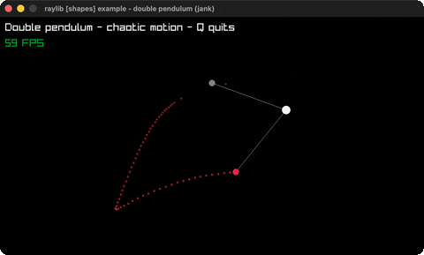

# double-pendulum

Chaotic double-pendulum motion + trail.

Category: shapes. Controls: Q quit.

Ported from raylib's `examples/shapes/shapes_double_pendulum.c`.



## Run it

```sh
cd double-pendulum && bb run   # from this demo (or lein run --disable-sandbox)
bb double-pendulum             # from the repo root
```

## About

raylib [shapes] example - double pendulum, ported to jank.

A chaotic double-pendulum simulation with a fading trail of the tip.
Press Q to quit. Based on
raylib/examples/shapes/shapes_double_pendulum.c (jank-native: C math.h
trig, scalar line/circle drawing, in-memory trail instead of a render
texture).
