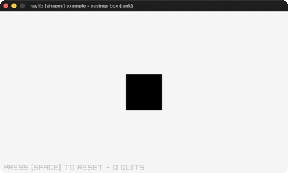

# easings-box

A box animated through five easing stages.

Category: shapes. Controls: SPACE reset · Q quit.

Ported from raylib's `examples/shapes/shapes_easings_box.c`.



## Run it

```sh
cd easings-box && bb run   # from this demo (or lein run --disable-sandbox)
bb easings-box             # from the repo root
```

## About

raylib [shapes] example - easings box, ported to jank.

A box animates through five easing stages: elastic drop, bounce to a
bar, quad rotate, circular grow, sine fade-out. SPACE resets, Q quits.
Based on raylib/examples/shapes/shapes_easings_box.c
(jank-native: easing fns from reasings.h via C sin; Rectangle + Vector2
built inline for DrawRectanglePro).
