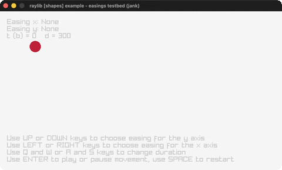

# easings-testbed

An interactive testbed for all 28 easings.

Category: shapes. Controls: ENTER play/pause · SPACE restart · L/R x-ease · U/D y-ease · Q/W A/S duration · T bounded · ESC quit.

Ported from raylib's `examples/shapes/shapes_easings_testbed.c`.



## Run it

```sh
cd easings-testbed && bb run   # from this demo (or lein run --disable-sandbox)
bb easings-testbed             # from the repo root
```

## About

raylib [shapes] example - easings testbed, ported to jank.

An interactive testbed for Robert Penner's easing equations: pick an
easing for the x axis and another for the y axis and watch a ball
animate along both. LEFT/RIGHT cycle the x easing, UP/DOWN cycle the
y easing, ENTER plays/pauses, SPACE restarts, Q/W and A/S change the
duration, T toggles bounded/unbounded time. ESC or the close button
quits (Q is taken by the duration control here, matching the C).
Based on raylib/examples/shapes/shapes_easings_testbed.c with the
easing functions from reasings.h.
(jank-native: all 28 easing fns are jank defns returning reals via C
sin/cos/sqrt/pow; dispatched by integer index through `ease`.)
