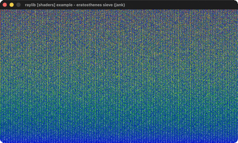

# eratosthenes-sieve

The Sieve of Eratosthenes per-pixel in a shader.

Category: shaders. Controls: ESC.

Ported from raylib's `examples/shaders/shaders_eratosthenes_sieve.c`.



## Run it

```sh
cd eratosthenes-sieve && bb run   # from this demo (or lein run --disable-sandbox)
bb eratosthenes-sieve             # from the repo root
```

It loads files from the vendored raylib checkout (`jank-raylib-sys/raylib/examples/shaders/resources/`) by a path relative to this directory, so run it from here. The repo's `jank-raylib-sys/raylib` submodule has to be checked out.

## About

raylib [shaders] example - eratosthenes sieve, ported to jank.

The Sieve of Eratosthenes computed per-pixel in a fragment shader:
every pixel maps to a number, primes light up, composites are dimmed
by their smallest factor. No uniforms, no input - the whole example
is the shader. ESC quits.
Based on raylib/examples/shaders/shaders_eratosthenes_sieve.c

jank-native notes: the C's blank-RenderTexture canvas trick (the
julia-set pattern) - a black RT drawn through the shader, which
derives everything from texture coordinates. Simplest shader port
yet: LoadShader + BeginShaderMode only.
