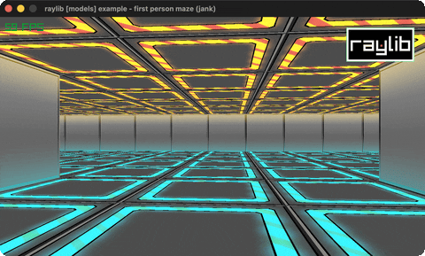

# first-person-maze

Walk a cubicmap maze in first person, with a radar.

Category: models. Controls: WASD + mouse look, ESC.

Ported from raylib's `examples/models/models_first_person_maze.c`.



## Run it

```sh
cd first-person-maze && bb run   # from this demo (or lein run --disable-sandbox)
bb first-person-maze             # from the repo root
```

It loads files from the vendored raylib checkout (`jank-raylib-sys/raylib/examples/models/resources/`) by a path relative to this directory, so run it from here. The repo's `jank-raylib-sys/raylib` submodule has to be checked out.

## About

raylib [models] example - first person maze, ported to jank.

Walk around inside the cubicmap maze in first person (WASD + mouse
look); wall collision is a 2D circle-vs-cell test against the maze
image, and a red dot tracks you on the top-right radar map. ESC
quits.
Based on raylib/examples/models/models_first_person_maze.c

jank-native notes:
- The C's LoadImageColors Color* collision array becomes a jank
  vector of 0/1 wall flags snapshotted at init with an inline
  GetImageColor read (walls never change, so the pixel array need
  not stay native).
- The collision response (camera.position = oldCamPos) is a cpp/=
  with an explicit trailing nil, since a cpp/= in tail position of a
  when clashes with the when's nil branch. The old position is read
  field-by-field
  off (.-position camera) into jank reals before UpdateCamera.
- Native bools stay out of and-chains: the CheckCollisionCircleRec
  test nests in its own when (rule 1).
