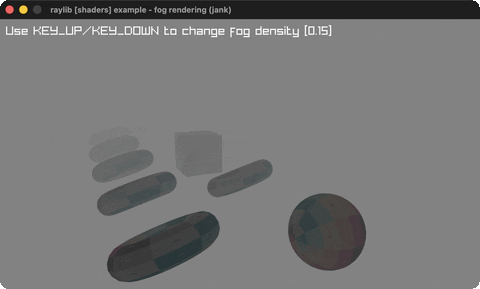

# fog-rendering

Torus/cube/sphere models fading into exponential fog.

Category: shaders. Controls: UP/DOWN fog density, ESC.

Ported from raylib's `examples/shaders/shaders_fog_rendering.c`.



## Run it

```sh
cd fog-rendering && bb run   # from this demo (or lein run --disable-sandbox)
bb fog-rendering             # from the repo root
```

It loads files from the vendored raylib checkout (`jank-raylib-sys/raylib/examples/shaders/resources/`) by a path relative to this directory, so run it from here. The repo's `jank-raylib-sys/raylib` submodule has to be checked out.

## About

raylib [shaders] example - fog rendering, ported to jank.

A spinning torus, a cube and a sphere (plus a receding row of
toruses) in exponential-squared fog under one point light; UP/DOWN
change the fog density. Orbital camera. ESC quits.
Based on raylib/examples/shaders/shaders_fog_rendering.c

jank-native notes:
- Lights come from the rlights namespace: light
  creation, viewPos push, shader.locs writes and all uniforms come
  from the header. Material texture/shader writes go through
  models.jank; the torus's per-frame transform spin is a cpp/=
  read-modify-write (MatrixMultiply/MatrixRotate via raymath.h).
- ColorNormalize(GRAY) reduces to (/ 130.0 255.0) components sent
  with sh/set-vec4!; fog density threads through recur as a
  jank real, clamped in jank.
