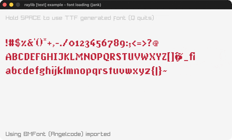

# font-loading

Load a BMFont and a TTF font (DrawTextEx).

Category: text. Controls: SPACE = TTF · Q quit.

Ported from raylib's `examples/text/text_font_loading.c`.



## Run it

```sh
cd font-loading && bb run   # from this demo (or lein run --disable-sandbox)
bb font-loading             # from the repo root
```

It loads files from the vendored raylib checkout (`jank-raylib-sys/raylib/examples/text/resources/`) by a path relative to this directory, so run it from here. The repo's `jank-raylib-sys/raylib` submodule has to be checked out.

## About

raylib [text] example - font loading, ported to jank.

Two custom fonts loaded and drawn with DrawTextEx: a BMFont
(AngelCode .fnt + .png atlas) via LoadFont, and a TTF rasterized at
load via LoadFontEx. Hold SPACE to switch to the TTF font, Q quits.
Based on raylib/examples/text/text_font_loading.c
(jank-native: Font is a native struct held as an outer-let local
like a Texture2D; .baseSize is read via .-baseSize (nth-boxed for
the cpp/float size arg). The C's message includes a Latin-1 upper
block; this port uses an ASCII-only sample so the jank lexer stays
happy - the font machinery is exercised identically.)
