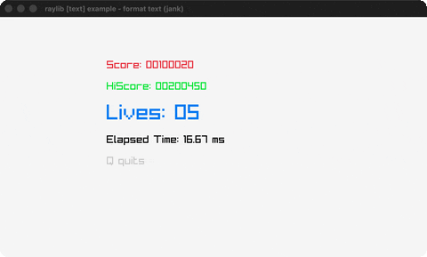

# format-text

Zero-padded score/time text readouts.

Category: text. Controls: Q quit.

Ported from raylib's `examples/text/text_format_text.c`.



## Run it

```sh
cd format-text && bb run   # from this demo (or lein run --disable-sandbox)
bb format-text             # from the repo root
```

## About

raylib [text] example - format text, ported to jank.

Zero-padded score / hiscore / lives readouts plus a live frame-time
readout, all with the default font. Q quits.
Based on raylib/examples/text/text_format_text.c
(jank-native: TextFormat's %08i / %02.02f become small jank string
helpers - there is no `format` in jank.)
