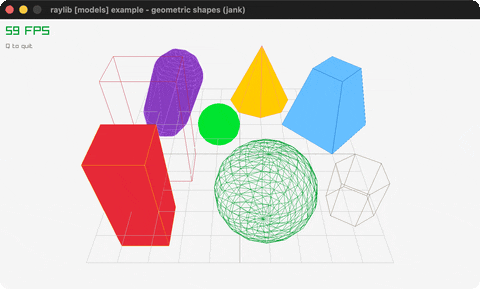

# geometric-shapes

3D cubes/spheres/cylinders/capsules on a grid.

Category: models. Controls: Q quit.

Ported from raylib's `examples/models/models_geometric_shapes.c`.



## Run it

```sh
cd geometric-shapes && bb run   # from this demo (or lein run --disable-sandbox)
bb geometric-shapes             # from the repo root
```

## About

raylib [models] example - geometric shapes, ported to jank.

The first models-category port: a static 3D scene of cubes,
spheres, cylinders, cones and capsules (solid + wireframe) over a
grid, viewed through a fixed perspective camera. Q quits.
Based on raylib/examples/models/models_geometric_shapes.c
(jank-native: every Vector3 is constructed inline as a call
argument; the Camera3D is an outer-let local.)
