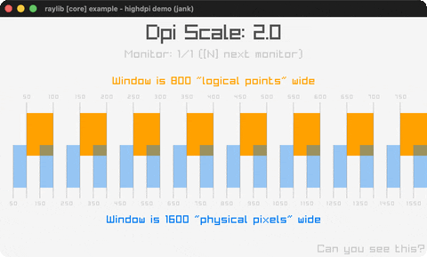

# highdpi-demo

Logical-points vs physical-pixels grids with live DPI scale.

Category: core. Controls: resize window · N next monitor · ESC.

Ported from raylib's `examples/core/core_highdpi_demo.c`.



## Run it

```sh
cd highdpi-demo && bb run   # from this demo (or lein run --disable-sandbox)
bb highdpi-demo             # from the repo root
```

## About

raylib [core] example - highdpi demo, ported to jank.

Visualises the difference between logical points and physical pixels on
a HighDPI display: an orange grid measured in logical points and a
translucent-blue grid measured in physical pixels, plus the live DPI
scale. Resize the window to watch the grids diverge; [N] moves to the
next monitor. ESC quits.
Based on raylib/examples/core/core_highdpi_demo.c

jank-native notes:
- GetWindowScaleDPI returns a native Vector2; its .-x is read once per
  frame in -main and re-boxed via `(nth [...] 0)` (rule 4).
- The centred-text helper measures with MeasureTextEx (native Vector2
  return, .-x/.-y read inside the helper - fine) and picks its Color
  inline by keyword id, since a jank fn can't take a native Color arg
  (rule 2). Colours are chosen with nested lookups that always end in a
  concrete cpp/Color.
- The CLITERAL(Color){0,121,241,100} pixel-grid fill is BLUE at alpha
  100/255, so it's built with `(cpp/Fade cpp/BLUE (cpp/float 0.392))`
  (cpp/Color's unsigned-char ctor rejects jank ints - see the guide).
