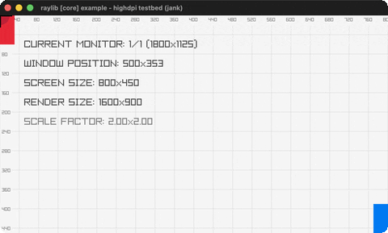

# highdpi-testbed

A HighDPI overlay: grid, monitor/DPI info, crosshair.

Category: core. Controls: SPACE borderless · F fullscreen · ESC.

Ported from raylib's `examples/core/core_highdpi_testbed.c`.



## Run it

```sh
cd highdpi-testbed && bb run   # from this demo (or lein run --disable-sandbox)
bb highdpi-testbed             # from the repo root
```

## About

raylib [core] example - highdpi testbed, ported to jank.

A diagnostic overlay for HighDPI / multi-monitor setups: a labelled
pixel grid, the current monitor + window position + screen/render size
+ DPI scale factor, corner reference rectangles, and a mouse crosshair
with live coordinates. SPACE toggles borderless-windowed, F toggles
fullscreen. ESC quits.
Based on raylib/examples/core/core_highdpi_testbed.c

jank-native notes: the per-frame native Vector2 reads (mouse, window
position, DPI scale) are boxed in -main via `(nth [...] 0)` (rule 4).
`%02i` / `%.2f` become the small `zero-pad` / `fmt2` jank helpers
(there is no `format` in jank; mirrors format_text.jank). Native ints
headed into `str` are boxed with `(int (cpp/...))`.
