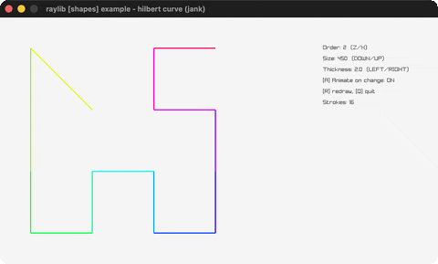

# hilbert-curve

A rainbow Hilbert space-filling curve.

Category: shapes. Controls: Z/X order · U/D size · L/R thickness · A animate · R redraw · Q.

Ported from raylib's `examples/shapes/shapes_hilbert_curve.c`.



## Run it

```sh
cd hilbert-curve && bb run   # from this demo (or lein run --disable-sandbox)
bb hilbert-curve             # from the repo root
```

## About

raylib [shapes] example - hilbert curve, ported to jank.

A rainbow Hilbert space-filling curve, animated one stroke per frame
when regenerated. Z/X step the order (2-8), hold DOWN/UP for the
total size, LEFT/RIGHT for the line thickness; A toggles
animate-on-change, R redraws, Q quits.
Based on raylib/examples/shapes/shapes_hilbert_curve.c
(jank-native: the calloc'd Vector2* path becomes a vector of point
maps rebuilt on change; the C's bit ops become mod/quot/doubling,
and its switch case-2 fallthrough into case 1 is transcribed as
x+=len AND y+=len. Beware order 8 = 65536 strokes - it works, but
the full-path draw is heavy.)
