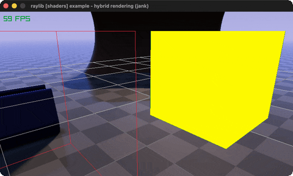

# hybrid-rendering

Raymarched spheres + rasterized cubes, depth-tested.

Category: shaders. Controls: ESC.

Ported from raylib's `examples/shaders/shaders_hybrid_rendering.c`.



## Run it

```sh
cd hybrid-rendering && bb run   # from this demo (or lein run --disable-sandbox)
bb hybrid-rendering             # from the repo root
```

It loads files from the vendored raylib checkout (`jank-raylib-sys/raylib/examples/shaders/resources/`) by a path relative to this directory, so run it from here. The repo's `jank-raylib-sys/raylib` submodule has to be checked out.

## About

raylib [shaders] example - hybrid rendering, ported to jank.

Raymarching and rasterization in ONE scene: a raymarch shader draws
spheres and writes real gl_FragDepth, then ordinary rasterized
cubes draw into the same depth-texture framebuffer - the two
worlds occlude each other correctly. An orbital camera circles the
mix. ESC quits.
Based on raylib/examples/shaders/shaders_hybrid_rendering.c

jank-native notes:
- Same rendertex.jank depth target as depth-writing.
- The per-frame camPos/camDir VEC3 push reads the camera fields with
  .-position / .-target and computes camDir = normalize(target -
  position) * camDist in jank.
- rlEnableDepthTest is a direct rlgl call (depth testing must be
  on manually while mixing rendering methods inside the FBO).
