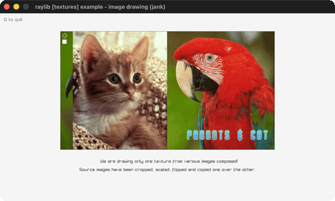

# image-drawing

One texture composed from several CPU images.

Category: textures. Controls: watch · Q quit.

Ported from raylib's `examples/textures/textures_image_drawing.c`.



## Run it

```sh
cd image-drawing && bb run   # from this demo (or lein run --disable-sandbox)
bb image-drawing             # from the repo root
```

It loads files from the vendored raylib checkout (`jank-raylib-sys/raylib/examples/textures/resources/`) by a path relative to this directory, so run it from here. The repo's `jank-raylib-sys/raylib` submodule has to be checked out.

## About

raylib [textures] example - image drawing, ported to jank.

One texture composed from several CPU images: a cat is cropped,
flipped, resized and drawn onto the parrots image, which is then
cropped and decorated with a pixel, a circle outline, a rectangle,
and custom-font text - all before a single LoadTextureFromImage.
Q quits. Cat & parrots sprites by Eiden Marsal.
Based on raylib/examples/textures/textures_image_drawing.c (the
submodule's raylib 6.0 version, which uses ImageDraw - the newer
ImageDrawImagePro with origin+rotation isn't in the linked lib, and
with rotation 0 / origin 0 the two are equivalent).

jank-native: every pointer-taking Image* op forms its pointer with
(cpp/& img) on a mutable let-local (see the pointer-interop section of
docs/guide/cpp-interop-toolbox.md). The source `cat` image is passed
by value to ImageDraw. All setup runs once before the loop; only the
final texture is drawn each frame.
