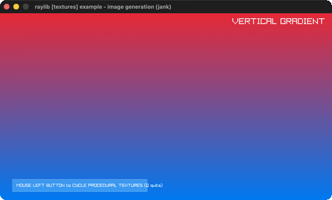

# image-generation

Nine procedural textures (gradients/noise).

Category: textures. Controls: LEFT mouse / RIGHT arrow cycle · Q quit.

Ported from raylib's `examples/textures/textures_image_generation.c`.



## Run it

```sh
cd image-generation && bb run   # from this demo (or lein run --disable-sandbox)
bb image-generation             # from the repo root
```

## About

raylib [textures] example - image generation, ported to jank.

Nine procedurally generated images (gradients, checked, white/perlin
noise, cellular) uploaded as textures. LEFT mouse or RIGHT arrow
cycles through them, Q quits.
Based on raylib/examples/textures/textures_image_generation.c
(jank-native: FIRST textures-category example. The C's Texture2D
array becomes nine outer-let bindings - native handles can't live in
a jank vector - with a nested-if draw dispatch on the current
index.)
