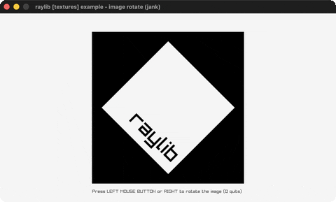

# image-rotate

The logo rotated +45/+90/-90 in CPU memory.

Category: textures. Controls: LEFT click / RIGHT cycle · Q quit.

Ported from raylib's `examples/textures/textures_image_rotate.c`.



## Run it

```sh
cd image-rotate && bb run   # from this demo (or lein run --disable-sandbox)
bb image-rotate             # from the repo root
```

It loads files from the vendored raylib checkout (`jank-raylib-sys/raylib/examples/textures/resources/`) by a path relative to this directory, so run it from here. The repo's `jank-raylib-sys/raylib` submodule has to be checked out.

## About

raylib [textures] example - image rotate, ported to jank.

The raylib logo loaded three times and each copy rotated in CPU
memory (+45, +90, -90 degrees) before becoming a texture. LEFT click
or RIGHT arrow cycles between them. Q quits.
Based on raylib/examples/textures/textures_image_rotate.c

jank-native: ImageRotate takes an Image* - formed with (cpp/& img) on
each mutable let-local. The three textures can't live in a jank
collection (native values), so they are three outer-let locals and the
current one is picked by index with nested `if` forms.
