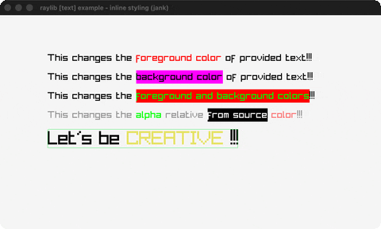

# inline-styling

Text with inline color style tags.

Category: text. Controls: watch the colors re-roll, ESC.

Ported from raylib's `examples/text/text_inline_styling.c`.



## Run it

```sh
cd inline-styling && bb run   # from this demo (or lein run --disable-sandbox)
bb inline-styling             # from the repo root
```

## About

raylib [text] example - inline styling, ported to jank.

Text with inline [ ] style tags: [cRRGGBBAA] sets the foreground color,
[bRRGGBBAA] the background color, [r] resets both. Several demo lines
plus a CREATIVE line whose color re-rolls every 20 frames, with its
measured bounds outlined. ESC quits.
Based on raylib/examples/text/text_inline_styling.c

jank-native notes:
- DrawTextStyled/MeasureTextStyled advance per glyph by
  font.glyphs[index].advanceX (or recs[index].width when 0) - the
  struct-array (cpp/aget ...) field reads again, this time inside
  helper fns, which is safe because no cpp/raw statics are involved
  (the per-fn duplication trap only bites mutable raw statics).
- The C duplicates the tag-scanning logic between draw and measure;
  the port factors ONE pure-jank tokenizer (next-token) both consume.
  Style state (front/back colors) threads as packed 0xRRGGBBAA ints,
  resolved with (cpp/GetColor v) at each draw (rule 2).
- strtoul(hex, 16) becomes a small jank hex parser over an index-of
  digit table; the C's TextFormat %02x becomes hex2 + str.
- Codepoints come from the ASCII-table trick in reverse: the demo
  strings are pure ASCII, so (+ 32 (str/index-of ASCII ch)) recovers
  the char code the C gets from GetCodepointNext (a documented
  simplification - the C walks UTF-8).
