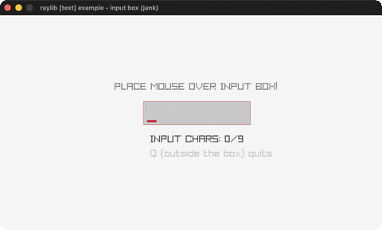

# input-box

A hover-to-type text input box.

Category: text. Controls: hover + type · BACKSPACE delete · Q (outside box) quit.

Ported from raylib's `examples/text/text_input_box.c`.



## Run it

```sh
cd input-box && bb run   # from this demo (or lein run --disable-sandbox)
bb input-box             # from the repo root
```

## About

raylib [text] example - input box, ported to jank.

Hover the box and type (up to 9 characters); BACKSPACE deletes, and
the cursor becomes an I-beam over the box. Q quits - but only while
the mouse is outside the box, so typing a 'q' works.
Based on raylib/examples/text/text_input_box.c
(jank-native: GetCharPressed returns an int char code and jank has no
char literals, so codes 32..125 index into an ASCII table string via
subs to yield one-char strings appended with str.)
