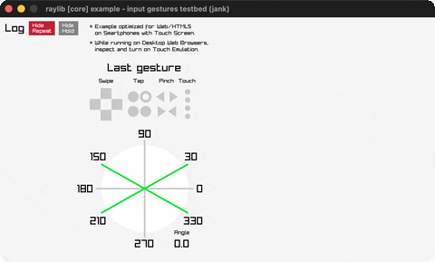

# input-gestures-testbed

A gesture dashboard with log, indicators and protractor.

Category: core. Controls: tap/drag/swipe with the mouse, click Hide buttons, ESC.

Ported from raylib's `examples/core/core_input_gestures_testbed.c`.



## Run it

```sh
cd input-gestures-testbed && bb run   # from this demo (or lein run --disable-sandbox)
bb input-gestures-testbed             # from the repo root
```

## About

raylib [core] example - input gestures testbed, ported to jank.

A gesture dashboard: a scrolling log of detected gestures (two buttons
toggle hiding repeats / holds), a 'last gesture' indicator panel, a
protractor showing the current drag/pinch angle, and circles at the
touch/mouse points. Works with the mouse on desktop (tap / double tap /
hold / drag / swipes); pinch needs a touch screen. ESC quits.
Based on raylib/examples/core/core_input_gestures_testbed.c

jank-native notes:
- GetGestureColor returned a Color from a switch - a jank fn can't
  return a native Color (rule 2), so gestures map to packed 0xRRGGBBAA
  ints resolved inline with (cpp/GetColor rgba) at each draw site (the
  random-sequence packing trick). GetGestureName becomes a jank map too.
- The C's char log[20][12] inverted ring buffer becomes a jank vector +
  index threaded through loop/recur; the drawing walk mods the index
  into range (the C reads log[20] out of bounds on its first frame -
  benign in C, an exception in jank).
- The angle readout trims TextFormat %f to two decimals; jank does the
  same with str + str/index-of + subs.
- GetTouchPosition returns a Vector2, bound per-iteration as a
  let-local (never crossing a fn boundary); sinf/cosf come from
  (:include "math.h") as cpp/sin + cpp/cos.
