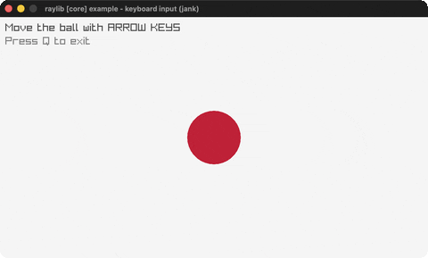

# input-keys

Steer a ball with the arrow keys.

Category: core. Controls: ARROWS · Q quit.

Ported from raylib's `examples/core/core_input_keys.c`.



## Run it

```sh
cd input-keys && bb run   # from this demo (or lein run --disable-sandbox)
bb input-keys             # from the repo root
```

## About

raylib [core] example - keyboard input, ported to jank.

Move the ball with the ARROW KEYS; it is clamped to the window.
Press Q to quit. Based on raylib/examples/core/core_input_keys.c
