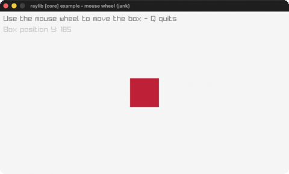

# input-mouse-wheel

Scroll a box with the mouse wheel.

Category: core. Controls: WHEEL · Q quit.

Ported from raylib's `examples/core/core_input_mouse_wheel.c`.



## Run it

```sh
cd input-mouse-wheel && bb run   # from this demo (or lein run --disable-sandbox)
bb input-mouse-wheel             # from the repo root
```

## About

raylib [core] example - mouse wheel input, ported to jank.

Scroll the mouse wheel to move a box up and down. Q quits.
Based on raylib/examples/core/core_input_mouse_wheel.c
