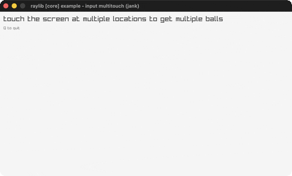

# input-multitouch

A ball at every active touch/mouse point.

Category: core. Controls: touch/click · Q quit.

Ported from raylib's `examples/core/core_input_multitouch.c`.



## Run it

```sh
cd input-multitouch && bb run   # from this demo (or lein run --disable-sandbox)
bb input-multitouch             # from the repo root
```

## About

raylib [core] example - input multitouch, ported to jank.

Draws an orange ball with an index number at every active touch
point. On a touchscreen each finger gets its own ball; on desktop
the mouse acts as touch point 0 while a button is held. Q quits.
Based on raylib/examples/core/core_input_multitouch.c
(jank-native: no fixed touch-point array is stored - GetTouchPosition
is queried inline in the draw loop, and its Vector2 is passed
straight to DrawCircleV, never carried in loop state.)
