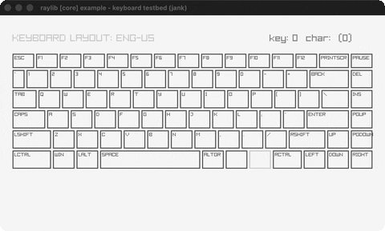

# keyboard-testbed

An on-screen ENG-US keyboard highlighting held keys.

Category: core. Controls: hold any keys, mouse hover; close window to quit.

Ported from raylib's `examples/core/core_keyboard_testbed.c`.



## Run it

```sh
cd keyboard-testbed && bb run   # from this demo (or lein run --disable-sandbox)
bb keyboard-testbed             # from the repo root
```

## About

raylib [core] example - keyboard testbed, ported to jank.

An on-screen ENG-US keyboard: every key you hold lights up MAROON, the
key under the mouse gets a red overlay, and the last GetKeyPressed /
GetCharPressed codes are shown top-right. SetExitKey(KEY_NULL) disables
the ESC shortcut (ESC is a testbed key here) - close the window to quit.
Based on raylib/examples/core/core_keyboard_testbed.c

jank-native notes:
- The C's parallel keycode/width arrays + GetKeyText switch collapse into
  one jank data structure: a vector of rows, each a vector of
  {:w :label :code} maps (codes boxed once with (cpp/int cpp/KEY_*) at
  def time). IsKeyDown takes the boxed code back through its int param.
- GuiKeyboardKey took a Rectangle by value; a native Rectangle can't
  cross a jank fn boundary (rule 2), so draw-key takes plain scalars in
  a map and builds the Rectangle as a let-local inside.
- The C TraceLogs key/char presses to the console; the port shows them
  on screen instead (same data, no vararg TraceLog interop needed).
