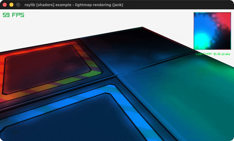

# lightmap-rendering

A plane lit by a baked lightmap through a second UV channel.

Category: shaders. Controls: ESC.

Ported from raylib's `examples/shaders/shaders_lightmap_rendering.c`.



## Run it

```sh
cd lightmap-rendering && bb run   # from this demo (or lein run --disable-sandbox)
bb lightmap-rendering             # from the repo root
```

It loads files from the vendored raylib checkout (`jank-raylib-sys/raylib/examples/shaders/resources/`) by a path relative to this directory, so run it from here. The repo's `jank-raylib-sys/raylib` submodule has to be checked out.

## About

raylib [shaders] example - lightmap rendering, ported to jank.

A plane lit by a BAKED lightmap: three colored flame sprites are
additively blended into a tiny 16x16 render texture once at init,
then the lightmap shader multiplies it (via a second UV channel)
over the plane's atlas texture forever after - no runtime lights.
The lightmap itself shows top-right. Orbital camera. ESC quits.
Based on raylib/examples/shaders/shaders_lightmap_rendering.c

jank-native notes:
- First DEEP MESH EDIT: GenMeshPlane makes no texcoords2, so jank
  MemAllocs the second UV channel, fills the four corners, uploads it
  with rlLoadVertexBuffer and wires vertex attribute 5 - all through
  (cpp/& mesh) on the let-local Mesh. Note rlSetVertexAttribute's last
  argument is an int OFFSET, not a pointer.
- GenTextureMipmaps must mutate the RenderTexture's OWN texture struct
  (the mipmaps count feeds SetTextureFilter's trilinear check), so the
  mipmap+filter pair runs against the boxed target; the plain
  texture's pair uses (cpp/& texture) directly.
- Material texture writes go through models.jank (ALBEDO = the atlas,
  METALNESS = the lightmap's texture).
