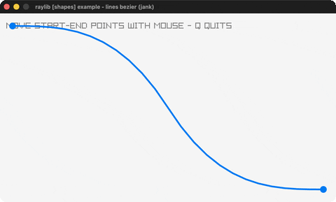

# lines-bezier

Drag endpoints to reshape a Bezier curve.

Category: shapes. Controls: drag endpoints · Q quit.

Ported from raylib's `examples/shapes/shapes_lines_bezier.c`.



## Run it

```sh
cd lines-bezier && bb run   # from this demo (or lein run --disable-sandbox)
bb lines-bezier             # from the repo root
```

## About

raylib [shapes] example - lines bezier, ported to jank.

Drag the two endpoints to reshape a cubic Bezier curve. Q quits.
Based on raylib/examples/shapes/shapes_lines_bezier.c
(jank-native: Vector2 built inline for CheckCollisionPointCircle +
DrawLineBezier).
