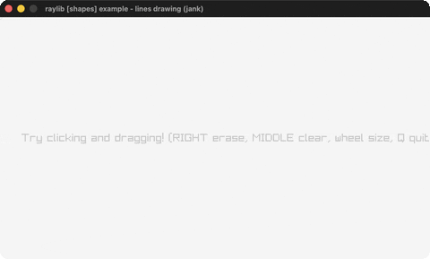

# lines-drawing

A paint canvas (RenderTexture).

Category: shapes. Controls: LEFT paint · RIGHT erase · MIDDLE clear · WHEEL size · Q.

Ported from raylib's `examples/shapes/shapes_lines_drawing.c`.



## Run it

```sh
cd lines-drawing && bb run   # from this demo (or lein run --disable-sandbox)
bb lines-drawing             # from the repo root
```

## About

raylib [shapes] example - lines drawing (a paint canvas), ported to jank.

Click-drag with the LEFT button to paint (the hue shifts as you move),
RIGHT button to erase, MIDDLE button to clear. Mouse wheel changes the
brush size. Q quits. Based on raylib/examples/shapes/shapes_lines_drawing.c

jank-native note: the paint persists on an offscreen RenderTexture. The
canvas is bound in a let OUTSIDE the frame loop - a native struct stays
usable inside the loop as long as it's not threaded through recur.
